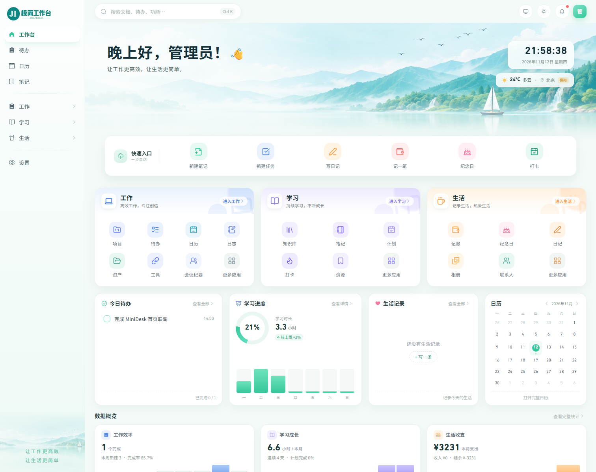
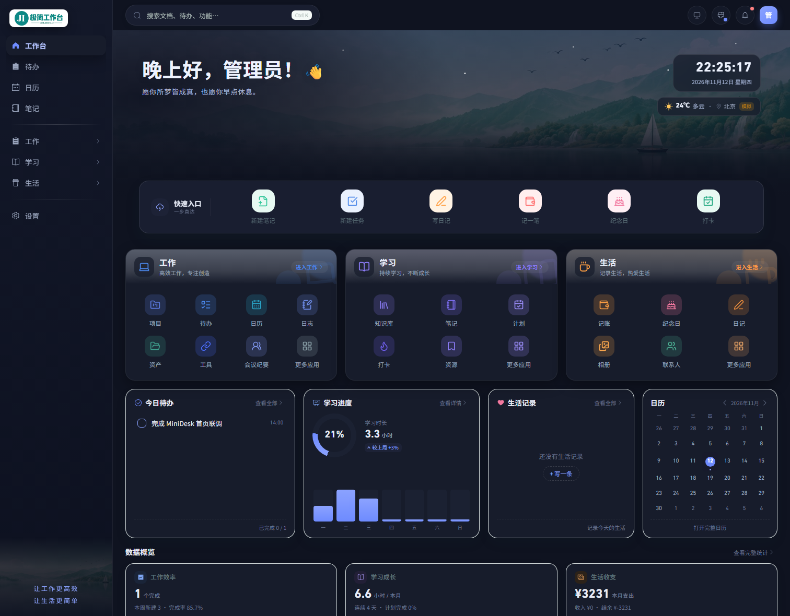

# MiniDesk · 极简工作台

> 一个可以自己部署的个人效率工作台。待办、日历、笔记、项目、记账、学习记录，都从同一个首页进入。




## 它解决什么问题

效率工具越多，切换成本越高：任务在一个应用、笔记在另一个应用、账单在第三应用，最后没人愿意打开。MiniDesk 把**高频动作收进一个首页**，把**同一类事情收进一个入口**——工作、学习、生活三个板块共用一套待办、一个日历、一个笔记编辑器、一次全局搜索。

数据放在自己的机器上，一个 SQLite 文件就是全部。多账号之间严格隔离，管理员也看不到别人的内容正文。

## 当前状态

这是 **v0.1.0 首个可运行版本**，不是完成品。请以代码为准，设计文档里标注为「规划」的部分尚未落地。

| 已经可用 | 规划中（尚未实现） |
| --- | --- |
| Vue 3 + Spring Boot 3 全栈，前后端分离开发、同源部署 | Quartz 持久化调度与后台手动触发 |
| 工作台首页、统一待办 / 日历 / 笔记 / 提醒 / 搜索 / 统计 | Tauri 桌面套壳、单 Jar 内置前端静态资源 |
| 工作 / 学习 / 生活三大板块共 14 个功能页 | 独立移动端 TabBar（当前仅 PC 优先的响应式） |
| 五套主题、可拖拽折叠侧栏、后台品牌 Logo 替换 | 备份与恢复、审计日志 AOP 自动埋点 |
| 自助注册（用户名 / 邮箱验证码）、角色权限、多账号隔离 | MySQL / PostgreSQL 运行时适配（DDL 已就绪） |
| `/console` 管理后台：用户、站点配置、品牌、发件邮箱、登录与操作日志 | 离线图标包、数据导入、家庭共享 |
| 和风天气集成（未配置自动降级为模拟数据）、Key 加密存储 | 逐页深度视觉重设计 |
| SQLite 59 张表 + MySQL 8 / PostgreSQL 14 完整建表 SQL | 完整自动化测试覆盖 |

## 主要功能

- **一个首页**：问候语与实时时钟、天气、快捷入口、三大板块卡片、今日待办、学习进度、生活记录、月历与数据概览。
- **六个统一入口**：待办（工作 / 学习 / 生活共用一张 `task` 表）、日历（任务起止、日程、考试、生日、纪念日、倒数日聚合）、笔记（Vditor Markdown）、提醒（顶栏铃铛）、全局搜索（顶栏 / `Ctrl+K`）、数据统计（工作台概览 + `/stats` 详情）。
- **三大板块**：工作（项目、日志、资产、工具、会议纪要）、学习（知识库、计划、打卡、资源）、生活（记账、纪念日、日记、相册、联系人）。
- **五套主题**：青绿 · 山水（默认）、紫色 · 极简、深色 · 星空、暖色 · 温馨、简约 · 纯净。主题同时驱动问候语、Hero 色调与 Element Plus 主色。
- **账号与权限**：Sa-Token JWT 无状态鉴权、MyBatis-Plus 租户插件自动注入 `user_id`、BCrypt 密码、登录失败锁定、登录与操作日志。管理员不可读取用户内容正文。
- **管理后台 `/console`**：独立布局，用户管理、注册开关、站点名称、横版 / 方形 Logo、SMTP 发件配置与日志审计。
- **个人中心**：头像、昵称、邮箱、密码修改。
- **集成配置**：设置页配置和风天气 API Key 与 Host，AES-GCM 加密落库、前端只回显掩码；未配置或请求失败时自动展示模拟天气并标注「模拟」。
- **交互细节**：侧栏宽度可拖拽（184–320px）、可折叠、双击复位；旧路由保留重定向，收藏夹不会失效。

| 青绿 · 山水（默认） | 深色 · 星空 |
| --- | --- |
|  |  |

## 技术栈

| 层 | 选型 |
| --- | --- |
| 前端 | Vue 3.5、TypeScript、Vite 8、Element Plus 2、Vue Router 4、Pinia 2、TanStack Vue Query 5、VueUse、Axios、Vditor 4、Sass、`@iconify/vue` |
| 后端 | Java 17、Spring Boot 3.5、MyBatis-Plus 3.5、Sa-Token 1.46（JWT 无状态）、Spring Mail、Caffeine、Hutool、SQLite JDBC |
| 数据库 | SQLite（默认）；MySQL 8 / PostgreSQL 14 建表脚本见 `backend/src/main/resources/db/` |
| 约定 | 统一 `Result` 响应体与 traceId、`MiniDesk-Token` 请求头、阿里 Java 开发规范、英文 Conventional Commits |

## 快速开始

### 环境要求

| 工具 | 版本 |
| --- | --- |
| JDK | 17+ |
| Maven | 3.9+ |
| Node.js | 20.19+ 或 22.12+ |
| npm | 10+ |

### 1. 启动后端

```bash
git clone https://github.com/cosolar/minidesk.git
cd minidesk/backend
mvn spring-boot:run -Dspring-boot.run.arguments="--server.port=18080"
```

> 必须在 `backend/` 目录下启动：数据库路径 `./data/minidesk.db` 与上传目录都相对工作目录。启动时会自动建表、写入角色与站点配置，无需手动执行 SQL。显式传入端口可避免环境变量 `PORT` 覆盖配置。

后端就绪：`http://127.0.0.1:18080/api`。

### 2. 启动前端

```bash
cd minidesk/frontend
npm ci
npm run dev
```

打开 `http://127.0.0.1:5180`，Vite 已把 `/api` 代理到 `18080`。

### 3. 首次使用

1. 打开登录页，点击「注册」。**第一个注册的用户自动成为管理员**，之后注册的都是普通成员。
2. 用管理员账号访问 `/console`，可关闭注册、改站点名称、上传 Logo、配置 SMTP。
3. 在「设置 → 集成配置」填入和风天气 Key；不填也能正常用，首页会显示模拟天气。
4. 邮箱验证码注册只在 SMTP 配置完成后才会在注册页出现。

> 项目**没有内置默认管理员账号和密码**，数据库文件也不在仓库中。公网部署前请务必设置 `MINIDESK_CLAIM_TOKEN`，避免陌生人抢注管理员，详见[部署指南](docs/部署指南.md)与[安全说明](SECURITY.md)。

## 构建

```bash
# 前端产物：frontend/dist/
cd frontend && npm run typecheck && npm run build

# 后端可执行 Jar：backend/target/minidesk.jar
cd backend && mvn -DskipTests package
```

当前版本前后端分别部署：用 Nginx 托管 `dist/` 并把 `/api` 反代到后端，注意配置 SPA fallback。完整的生产配置、HTTPS、备份与三库切换说明见 [docs/部署指南.md](docs/部署指南.md)。

## 配置

后端通过环境变量覆盖 `application.yml`：

| 变量 | 默认值 | 说明 |
| --- | --- | --- |
| `SA_TOKEN_SECRET` | `minidesk-dev-secret-please-override-in-prod` | JWT 签名密钥，**生产必须替换**为长随机串 |
| `MINIDESK_CLAIM_TOKEN` | 空 | 设置后，首个注册者必须填写该令牌才能成为管理员 |
| `SPRING_DATASOURCE_URL` | `jdbc:sqlite:./data/minidesk.db` | 数据源地址 |
| `SERVER_PORT` | `18080` | 建议用命令行参数显式指定 |

前端构建期变量见 [`.env.example`](.env.example) 与 `frontend/.env.*`；站点名称、Logo、天气 Key、SMTP 等运行时配置都在界面里改，存数据库。

## 目录结构

```
minidesk/
├── frontend/                 # Vue 3 前端
│   ├── src/app/              # 路由、守卫、应用入口
│   ├── src/core/             # 请求封装、Pinia stores、主题目录
│   ├── src/layouts/          # 主布局与后台布局
│   ├── src/features/         # 按业务域划分的页面（work / study / life / console ...）
│   ├── src/shared/           # 通用组件（MarkdownEditor、ThemePicker ...）
│   └── src/styles/           # 主题变量与 Element Plus 覆盖
├── backend/                  # Spring Boot 3 后端
│   ├── src/main/java/cn/minims/desk/
│   │   ├── common/           # 统一响应、异常、错误码
│   │   ├── config/           # MyBatis-Plus、Sa-Token 配置
│   │   ├── framework/        # 租户、加密、数据库升级、鉴权
│   │   ├── bootstrap/        # 启动种子数据
│   │   └── modules/          # 按业务域划分的模块
│   └── src/main/resources/db/# SQLite / MySQL / PostgreSQL 建表 SQL
├── docs/                     # 设计文档、接口清单、部署指南、截图
├── scripts/gen_schema.py     # 由 SQLite schema 生成 MySQL / PostgreSQL DDL
├── AGENTS.md                 # 开发规范与质量门禁
└── README.md
```

## 文档

| 文档 | 内容 |
| --- | --- |
| [文档索引](docs/README.md) | 各文档的用途与「设计蓝图 / 已实现」状态说明 |
| [开发总纲](docs/MiniDesk开发文档.md) | 产品决策、信息架构、功能矩阵、前后端规范、部署与风险 |
| [数据库设计](docs/数据库设计.md) | 59 张表的字段、索引与隔离约定 |
| [接口清单](docs/接口清单.md) | 全部 REST 接口、请求响应体、权限码 |
| [部署指南](docs/部署指南.md) | 本地开发、生产部署、三库切换、备份与 FAQ |
| [AGENTS.md](AGENTS.md) | 编码规范、门禁、提交规范、常见任务配方 |

## 路线图

- **v0.2**：Quartz 持久化调度与后台手动触发、备份恢复、审计 AOP、单 Jar 内置静态资源。
- **v0.3**：MySQL / PostgreSQL 运行时适配（驱动、方言、幂等升级）、离线图标包。
- **v1.0**：Tauri 桌面端、移动端专属导航、数据导入导出、逐页视觉打磨。

## 贡献

欢迎 Issue 与 Pull Request。动手前请先读 [CONTRIBUTING.md](CONTRIBUTING.md) 与 [AGENTS.md](AGENTS.md)：新增业务表必须带 `user_id`、三套建表 SQL 需同步、提交信息使用英文 Conventional Commits。

## 许可证

[MIT](LICENSE) © MiniDesk contributors
