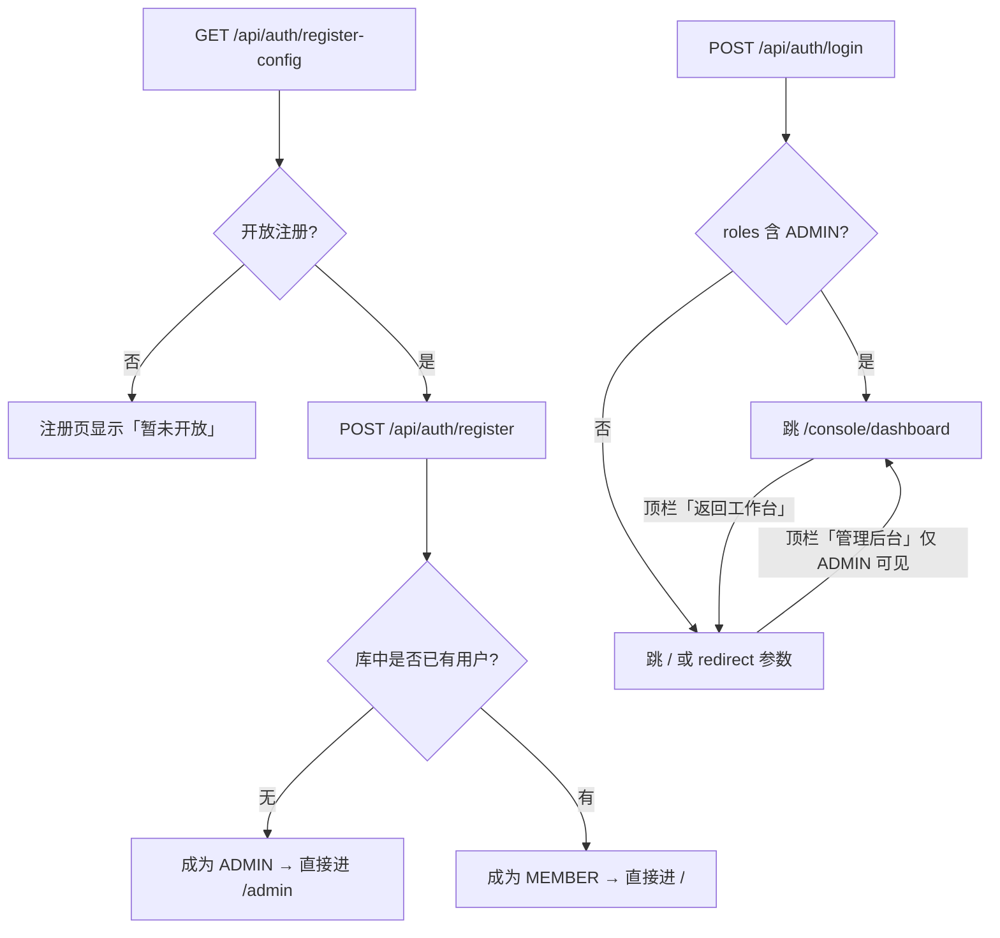
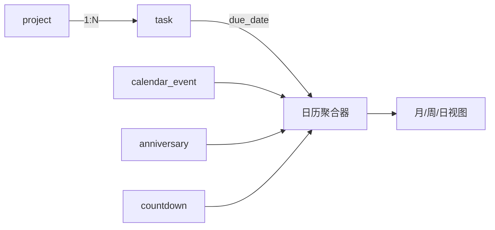

# MiniDesk 极简工作台 · 开发总纲

> 版本：v1.0（决策定稿）
> 日期：2026-11-12
> 上一版：v0.1（仅首页规划）
> 配套文档：[数据库设计](./数据库设计.md) · [接口清单](./接口清单.md) · [部署指南](./部署指南.md)

> **阅读提示**：本文是设计蓝图与决策记录，「排期」「待确认」「多端方案」「Tauri」等章节描述的是目标形态，**不代表当前代码已实现**。单 Jar、Quartz 调度、备份恢复、审计 AOP 与移动端导航已落地，但实现方式与本文早期设想有差异（例如调度用 RAMJobStore + 自建表，不用 QRTZ_*）。当前状态以 [README.md](../README.md) 与 [CHANGELOG.md](../CHANGELOG.md) 为准，实际部署步骤以 [部署指南](./部署指南.md) 为准。

---

## 1. 决策定稿

关键决策已全部确定，落地方式如下：

| 事项 | 决定 | 落地要点 |
|---|---|---|
| 天气 | **和风天气**，Key 存数据库 | 后台设置页配置；Key 用 AES-GCM 加密落库；未配置时走 Mock Provider，前端显示「模拟数据」角标 |
| 登录 | **多账号隔离 + Sa-Token 鉴权** | Sa-Token 1.4x（JWT 无状态模式，不依赖 Redis）；角色 + 权限码做轻量 RBAC；数据隔离靠 MP 租户插件自动注入 `user_id` |
| 数据库 | **开发用 SQLite**，完成后同步产出 MySQL 8 / PostgreSQL 完整 SQL | schema 用 Liquibase 单一来源定义，`update-sql` 一键导出三套 DDL |
| 编辑器 | **Vditor 统一封装** | 笔记、工作日志、会议纪要、复盘、读书笔记、日记全部复用同一个 `MarkdownEditor` |
| 定时任务 | **Quartz**，可持久化 + 界面手动触发 | `QRTZ_*` 表随主库建；后台「定时任务」页列出 Job、支持「立即执行」与「暂停」 |
| 桌面端 | **V1 就上 Tauri 套壳** | JRE 用 jlink 裁剪后作为 sidecar 随包；同一套前端代码，运行时判断环境 |
| 移动端 | **响应式 H5 优先**，PWA 可选 | 移动端独立 TabBar + 抽屉导航；Tauri 2 Mobile 列三期评估（见 §9.4） |
| 管理后台 | **独立界面，与用户端分离** | 管理员登录后进 `/console`，独立布局与视觉；用户管理、角色权限、审计、监控；**不可读取用户内容正文**（见 §4） |
| 注册 | **开放自助注册** | 任意访客可注册，默认 `MEMBER` 角色；后台可一键关闭注册开关；**库中第一个注册者自动成为 ADMIN**（见 §4.6） |

---

## 2. 信息架构

### 2.1 PC 端侧边栏

```
工作台                    ← 首页看板（含数据概览）
──────────────
待办        工作 / 学习 / 生活 三板块的待办都在一处
日历        工作日程、任务起止、考试、生日、纪念日
笔记        工作记录、学习笔记、生活日记
──────────────
工作 ▾
  ├ 项目        ├ 日志        ├ 资产
  ├ 书签        └ 会议纪要
学习 ▾
  ├ 知识库      ├ 计划        ├ 打卡        └ 资源
生活 ▾
  ├ 记账        ├ 纪念日      ├ 日记
  ├ 相册        └ 联系人
──────────────
设置
```

**三个「不进侧栏」的页面**（导航即入口，避免菜单越堆越长）：

| 页面 | 入口 | 原因 |
|---|---|---|
| 提醒中心 `/reminders` | 顶栏铃铛（带未读红点） | 属于「被告知」而非「主动打开」 |
| 全局搜索 `/search` | 顶栏搜索框、`Ctrl + K` | 搜索是动作，不是目的地 |
| 数据统计 `/stats` | 工作台底部「数据概览」→ 查看完整统计 | 概览放首页，明细页做下钻 |

**设计原则**：能「一次看到全部」的能力做统一入口；只在某个板块内才有意义的能力放分组里。
任务、日历、笔记不再各板块各放一份——同一个东西只有一个家。

**侧栏交互**：右侧有 6px 拖拽热区，宽度 184–320px，双击恢复 216；顶栏与品牌行都能收起/展开。
宽度与折叠状态存 localStorage（`minidesk:sidebar-width` / `minidesk:sidebar-collapsed`）。

**品牌**：站点名、横版 Logo、方形 Logo 可在后台「系统设置 → 品牌设置」替换；
未配置时回退内置的 `logo-wide.webp` / `logo-mark.webp`。登录页与侧栏共用同一份配置
（`GET /api/site` 公开接口，不走 token）。

### 2.2 移动端 TabBar

`工作台 · 待办 · 记账 · 学习 · 我的`

「我的」聚合：日历、笔记、收藏、设置、账号切换。

### 2.3 路由总量

约 52 条路由（含管理后台与详情页），全部懒加载。完整清单见 §6.3。

---

## 3. 功能矩阵

### 3.0 收录标准

2026-11-12 三次修订：从「按板块罗列」改为「按场景统一」。

一条能力进侧栏，需同时满足：**高频**、**有联动**、**有沉淀**。此外新增一条硬规则：

> **同一个概念只能有一个入口。** 任务、日历、笔记天然跨板块，就必须做成统一入口；
> 放进三个板块各一份，等于让用户每天在三个地方找同一件事。

| 统一入口 | 覆盖范围 | 数据来源 |
|---|---|---|
| 待办中心 | 工作 / 学习 / 生活 | `task`（module 区分） |
| 统一日历 | 工作日程、任务起止、考试、生日、纪念日、倒数 | `calendar_event` `task` `exam` `contact` `anniversary` `countdown` |
| 提醒中心 | 逾期、今天到期、三天内、生日、纪念日、计划到期 | 实时聚合，不落通知表 |
| 统一笔记 | 工作记录 / 学习笔记 / 生活日记 | `note`（module + type）、日记走 `life_log` |
| 全局搜索 | 9 个域一次搜完 | LIKE + 显式 user_id |
| 数据统计 | 效率 / 学习 / 收支 | 任务、学习记录、账单 |

**提醒中心为什么不落库**：存成通知表就要处理「任务改期后旧提醒怎么撤回」「完成后通知还留着」两类不一致。
实时聚合永远和源数据一致，代价只是一次多表查询。

### 3.1 页面清单（19 个侧栏入口 + 3 个隐藏页）

| 分区 | 页面 | 路由 |
|---|---|---|
| 全局 | 工作台（含数据概览） | `/` |
| 统一 | 待办 | `/todo` |
| 统一 | 日历 | `/calendar` |
| 统一 | 笔记 | `/note` |
| 隐藏 | 提醒中心（顶栏铃铛） | `/reminders` |
| 隐藏 | 全局搜索（顶栏搜索 / Ctrl+K） | `/search` |
| 隐藏 | 数据统计（工作台概览下钻） | `/stats` |
| 工作 | 项目 | `/work/project` |
| 工作 | 日志 | `/work/journal` |
| 工作 | 资产 | `/work/asset` |
| 工作 | 书签 | `/work/tool` |
| 工作 | 会议纪要 | `/work/meeting` |
| 学习 | 知识库 | `/study/kb` |
| 学习 | 计划 | `/study/plan` |
| 学习 | 打卡 | `/study/checkin` |
| 学习 | 资源 | `/study/resource` |
| 生活 | 记账 | `/life/ledger` |
| 生活 | 纪念日 | `/life/anniversary` |
| 生活 | 日记 | `/life/diary` |
| 生活 | 相册 | `/life/album` |
| 生活 | 联系人 | `/life/contact` |
| 系统 | 设置 | `/settings` |

### 3.2 数据表保留、暂不做页面

| 功能 | 替代方式 |
|---|---|
| 会议记录 | 新建笔记，`type = meeting` |
| 目标管理 | 项目承载 + 复盘里写月度目标 |
| 日常工作 / 学习任务 / 日常计划 | 待办按 `module` 筛选 |
| 工作资料 / 家庭相册 | 本地网盘或对象存储，不进主流程 |
| 联系人 | 手机通讯录 |
| 课程管理 | 学习计划里的「科目」，不单独建页面 |
| 考试计划 | 学习计划 + 纪念日倒计时 |
| 购物清单 | 记账的「备注 + 分类」，不单设页面 |
| 技能成长 | 学习复盘里的阶段总结 |
| 资产管理 | 记账的 `account_id` 字段已预留 |
| 健康管理 | 打卡（体重、运动各建一个打卡项） |
| 个人档案 | 纪念日的「证件到期」类型 |
| 旅行管理 | 纪念日（倒计时）+ 生活记录 |
| 愿望清单 | 生活记录里写 |
| 收藏 | 笔记置顶 |

### 3.3 明确不做

- 多用户协作、评论、@提醒（单用户/家庭场景没有对象）
- 社交分享、公开主页（隐私工具，不引入外部可见面）
- 富文本以外的排版系统、模板市场
- 第三方日历双向同步（先做只读聚合 + iCal 导出）

### 3.4 联动关系（留下来的功能必须连成网）

```
任务 ──start_date / due_date──→ 日程安排（两个落点，看得出工期）
  │                              ↑
  ├──project_id──→ 项目（进度自动算）  ←── 会议跟进事项（一键转任务）
  └──done_at─────→ 日志（自动汇总本周/本月完成）
                       ↑
                   笔记（Markdown 直接引用）

资产 ←── 外链飞书/腾讯 + 自建 Markdown + 上传附件

书签 / 资源 ── 同一张 nav_link 表，module 区分

记账 ←── 月度支出──→ 日志月报（自动带出金额）

打卡 ──log_date──→ 连续天数 / 热力图（学习与生活共用）

联系人 ──birthday──→ 纪念日提醒（避免两处重复录入）
```

## 4. 管理后台（Console）

管理员不是「权限更大的用户」，而是一个**独立的产品面**：登录后进入的是后台控制台，不是用户工作台。因此它有自己的布局、视觉语言、路由树和权限边界。

> **命名约定**：路径统一 `/console`，接口前缀 `/api/console`，前端目录 `features/console`，后端包 `modules/console`。
> 而 Sa-Token 的角色码仍叫 `ADMIN`、权限码仍是 `system:*`——路径讲「在哪」，角色讲「是谁」，两者不混用。

### 4.1 双端结构与登录分流

一套前端代码，两套布局：

```
/register                   自助注册（开放时；首个注册者自动成为管理员）
/login                      统一登录页（薄荷绿，用户端视觉）
  ├─ 角色含 ADMIN  → /console/dashboard   后台控制台（深色侧栏 + 靛蓝主色）
  └─ 其他          → /                用户工作台（薄荷绿 + 卡片流）
```



设计要点：

1. **单一登录入口**，不搞 `/console/login` 双登录页——两套登录页会带来两套验证码/锁定策略，收益为零。注册同理，只有 `/register` 一个。
2. **管理员默认进后台，但仍是普通用户**：`ADMIN` 角色的权限含 `*`，因此前台所有业务功能照常可用（自己的待办、记账、笔记）。顶栏提供「返回工作台」双向切换。
3. **前台顶栏的「管理后台」入口只对 ADMIN 渲染**（`v-permission`），但真正的边界在后端 `@SaCheckRole("ADMIN")`。
4. **注册态由后端判定**，前端不猜：`GET /api/auth/register-config` 返回 `{ allowRegister, isFirstUser, needClaimToken, passwordPolicy }`，注册页据此显示提示（如「你是第一个用户，将获得管理员权限」）。
5. **路由守卫**：

```ts
router.beforeEach((to) => {
  const user = useUserStore()
  if (to.meta.public) return true
  if (!user.isLoggedIn) return { name: 'login', query: { redirect: to.fullPath } }
  if (to.matched.some(r => r.meta.requiresAdmin)) {
    if (!user.isAdmin) return { name: 'forbidden' }   // /403，不是 404
    if (to.name === 'console-root') return { name: 'console-dashboard' }  // 二次登录直接进后台
  }
  return true
})
```

5. **两套 Layout 不共用**：`UserLayout`（侧栏 200px、卡片、18px 圆角）与 `ConsoleLayout`（侧栏 220px 深色、表格、8px 圆角）各自独立，只共享 `shared/components` 里的基础件（空态、分页、确认弹窗）。

### 4.2 后台信息架构

```
概览 ─ 用户管理 ─ 角色权限 ─ 数据统计
系统监控 ─ 定时任务 ─ 备份恢复 ─ 集成配置
审计日志 ─ 系统设置
```

| 菜单 | 路由 | 能力 | 权限码 | 优先级 |
|---|---|---|---|---|
| 概览 | `/console/dashboard` | 用户总数、7 日活跃、数据总量、系统健康度 | `system:dashboard:query` | P0 |
| 用户管理 | `/console/users` | 列表、新建、编辑、禁用/启用、重置密码、分配角色、删除 | `system:user:manage` | P0 |
| 角色权限 | `/console/roles` | 角色 CRUD、权限码分配（内置角色不可删） | `system:role:manage` | P1 |
| 数据统计 | `/console/stats` | 注册趋势、活跃分布、各模块数据量 | `system:stats:query` | P1 |
| 系统监控 | `/console/system` | CPU/内存/磁盘/库大小/JVM/线程池（OSHI + Actuator） | `system:monitor:query` | P1 |
| 定时任务 | `/console/jobs` | 任务列表、立即执行、暂停/恢复、执行日志 | `system:job:manage` | P1 |
| 备份恢复 | `/console/backup` | 全库备份、下载、恢复、保留策略 | `system:backup:manage` | P1 |
| 集成配置 | `/console/integrations` | 全局默认天气 Key / 知识库地址与 mdt_ 令牌（用户未配置时回退） | `system:integration:update` | P2 |
| 审计日志 | `/console/audit` | 操作日志、登录日志、失败登录告警 | `system:audit:query` | P1 |
| 系统设置 | `/console/settings` | 站点名、是否开放注册、密码策略、登录失败锁定阈值 | `system:setting:update` | P2 |

> 以上是早期蓝图。当前实现是 `integration_config` **按用户隔离**（租户插件注入 `user_id`），没有 `user_id = 0` 的全局回退；天气在设置页按人配置，知识库令牌同理，另提供 `MINIDESK_MINIDOCS_TOKEN` 作为首次启动导入入口，见 §5.8。

### 4.3 用户管理（后台的核心页）

**列表列**：ID、用户名、昵称、角色、状态、**来源**（自助注册 / 管理员创建）、数据量（任务/笔记/记账）、注册时间、最后登录、操作。

**筛选**：关键词（用户名/昵称）、角色、状态、注册时间区间。

**操作**：

| 操作 | 行为 | 约束 |
|---|---|---|
| 新建用户 | 填用户名、昵称、初始密码、角色 | 用户名唯一；密码强度校验 |
| 编辑 | 改昵称、邮箱、角色 | 不能改自己的角色 |
| 禁用 / 启用 | `status` 0/1，禁用后 Sa-Token `StpUtil.disable(userId, seconds)` | 不能禁用自己 |
| 重置密码 | 生成 16 位临时密码，置 `pwd_reset_required = 1` | 明文只返回一次，不入日志 |
| 删除 | 软删 `deleted = 1` | 30 天后由 `CleanTrashJob` 清理；期间可恢复 |
| 查看数据 | 只显示**数量统计**，不显示笔记/日记/生活记录正文 | 隐私边界，见下 |

**四条保护规则（必须实现，属于缺陷级）**：

1. **不能禁用/删除自己**，防止自锁。
2. **最后一个 ADMIN 不可删除、不可降级、不可禁用**——服务层在事务内 count 一次再判断，不能只靠前端。
3. **管理员不能修改自己的角色与权限**，防止提权；改角色必须由另一个管理员操作。
4. **重置密码后的临时密码只在响应里出现一次**，不写日志、不回显历史。

**隐私边界（重要）**：

后台能看到「用户 A 有 128 条笔记」，但**看不到任何一条笔记内容**。系统不提供"以管理员身份查看用户数据"的能力。

理由：这是个人隐私工具，笔记、日记、记账、健康数据都属于敏感内容。管理员需要的是容量与账号管理，不是内容审查。若将来确有需求（如家庭共享账单排查），应做成「用户主动授权」而非「管理员默认可见」。

落实：`/console/**` 的 Service 只允许调用 `count` 类聚合查询，代码评审时禁止 `selectById` 等读取业务正文的调用进入 console 模块。

### 4.4 两套界面的视觉差异

后台不做成"用户的深色版"，而是另一套信息密度更高的语言。

| 维度 | 用户端 | 管理后台 |
|---|---|---|
| 主色 | 薄荷绿 `#35C79B` | 靛蓝 `#4C6FFF` |
| 侧栏 | 浅色渐变 + 山形装饰，200px | 深色 `#1B2230`，文字 `#E6EAF2`，220px（折叠 64） |
| 页面底色 | `#F5FAF8` | `#F5F7FA` |
| 卡片圆角 | 18px | 8px |
| 信息载体 | 卡片流、宫格、图表 | 表格、表单、描述列表 |
| 行高 / 字号 | 宽松，基准 14px | 紧凑，基准 13px，表格行高 44 |
| 内容宽度 | 最大 1440 居中 | 全宽自适应，`padding: 20` |
| 组件来源 | 自写卡片 + Element 表单 | Element Plus Table / Form / Descriptions 为主 |
| 动效 | 卡片 hover 抬起、数字滚动 | 只保留表格 hover 与抽屉，不做装饰动效 |

**不要复用**首页的 `HeroBanner` `ModuleCard` `AppGrid` —— 那些是用户端语汇，搬进后台会显得不专业。

### 4.5 安全与审计

| 措施 | 实现 |
|---|---|
| 接口鉴权 | `/console/**` 全部 `@SaCheckRole("ADMIN")` + 具体权限码 |
| 操作审计 | `sys_oper_log`：操作人、动作、目标类型/ID、参数摘要（脱敏）、IP、UA、耗时、结果、traceId |
| 登录日志 | `sys_login_log`：成功/失败、IP、UA、失败原因；连续失败 5 次锁定 15 分钟（`LoginFailLock`） |
| 审计不可篡改 | `sys_oper_log` 只增不改不删，无编辑接口；清理仅按保留策略（默认 180 天） |
| 敏感操作二次确认 | 删除用户、恢复备份、重置密码需输入目标用户名/`RESTORE` 确认 |
| 不提供的能力 | 后台没有"执行 SQL""查看用户正文""修改他人密码为指定值" |

登录失败锁定用 Sa-Token 的 `StpUtil.disable` 不合适（会与账号禁用混淆），单独用 Caffeine 计数：`loginFail:{username}`，5 次 / 15 分钟窗口，成功登录清零。

### 4.6 注册与首个管理员

**开放注册**，规则如下：

| 场景 | 行为 |
|---|---|
| 库中没有任何用户 | 注册者自动获得 `ADMIN` 角色，注册后直接进 `/console`；注册页顶部提示「你是第一个用户，将获得管理员权限」 |
| 库中已有用户 | 注册者获得 `MEMBER` 角色，注册后直接进 `/` |
| 管理员关闭注册开关 | `/register` 显示「暂未开放注册」，后端 `POST /auth/register` 返回 `60020` |
| 部署在公网且担心被抢注 | 设置环境变量 `MINIDESK_CLAIM_TOKEN`，首个注册者必须填写该 token 才能成为管理员；不设置则本机直接注册 |
| 无人值守初始化 | 启动参数 `--minidesk.init-admin=admin:Init@123456`，仅在库为空时创建，密码强制 `pwd_reset_required = 1` |

**「第一个用户」的判定必须在事务内做**，靠 `count(*) = 0` 而不是前端传参：

```java
@Transactional(rollbackFor = Exception.class)
public LoginVO register(RegisterDTO dto) {
    boolean firstUser = userMapper.selectCount(null) == 0;   // 事务内，别无脑缓存
    Long userId = userService.create(dto, firstUser ? RoleCode.ADMIN : RoleCode.MEMBER);
    initUserData(userId);                                    // 设置 + 分类 + 宫格
    StpUtil.login(userId);
    return loginHelper.buildLoginVO(userId);
}
```

并发注册（两个请求同时通过 `count == 0`）由一个唯一索引兜底：`sys_config` 中的 `install_claimed` 标志用 `UPDATE ... WHERE config_value = '0'` 抢占，抢不到的一方降级为 `MEMBER`。

**账号开通后自动写入的数据**（同一事务）：

1. `sys_user_role`：ADMIN 或 MEMBER
2. `sys_user_setting`：默认城市、主题 `auto`、周起始 1
3. `ledger_category`：12 条默认收支分类
4. `app_entry`：22 条首页宫格与快捷入口

**注册字段**：用户名、昵称、密码、确认密码；邮箱选填（无邮件服务，不做邮箱找回）。

**忘记密码**：不做自助找回（SMTP 仅用于注册验证码），登录页提示「忘记密码请联系管理员重置」。管理员重置后生成一次性临时密码，用户下次登录强制改密——这条链路已经在后台用户管理里实现，不需要额外开发。

**防滥用**：

- 同 IP 每小时最多注册 3 个账号（Caffeine 计数）
- 关闭注册后，旧的 `/register` 页面直接 404 而不是报错
- 用户名保留字：`admin` `administrator` `root` `system` 允许使用但不获得额外权限，权限只由角色决定（避免「名字像管理员」的社工风险）

### 4.7 实现落点

| 内容 | 位置 |
|---|---|
| 路由树 | `app/router/console.routes.ts`，`meta.requiresAdmin = true` 统一挂载 |
| 注册 / 登录 | `features/auth/views/{LoginView,RegisterView}.vue`，注册成功后按角色分流 |
| 布局 | `features/console/layout/ConsoleLayout.vue`、`ConsoleSidebar.vue`、`ConsoleHeader.vue` |
| 页面 | `features/console/{dashboard,users,roles,stats,system,jobs,backup,integrations,audit,settings}/views/` |
| 后端 | `modules/console/`（只做管理编排，不复制业务逻辑；统计走 `count` 聚合） |
| 表 | `sys_login_log`、`sys_oper_log`（见数据库文档 §3.1） |
| 接口 | 见接口清单 §15 |

---

## 5. 重点专题设计

### 5.1 统一事项模型（最重要的一个决策）

「待办事项」「学习任务」「日常计划」「会议待跟进」本质都是「一件事」。若各建一张表，会出现：日历要聚合 4 处、复盘要查 4 处、搜索要写 4 个分支、移动端要维护 4 套组件。

**统一为 `task` 一张表**，用三个维度区分：

| 字段 | 取值 | 作用 |
|---|---|---|
| `module` | work / study / life | 板块归属，决定默认视图与配色 |
| `task_type` | todo / study / daily / followup | 业务类型，决定表单字段 |
| `ref_type` + `ref_id` | project / plan / meeting / shopping | 关联对象，实现跨模块挂载 |

由此天然获得：
- 项目详情页的「任务列表」= `task where project_id = ?`
- 学习计划的「本周任务」= `task where plan_id = ?`
- 会议「待跟进」转任务 = 新建 task 并回写 `meeting_action.task_id`
- 首页「今日待办」= `task where due_date = today and status != done`

**重复任务**：存 iCal RRULE 字符串（`FREQ=WEEKLY;BYDAY=MO,WE`），由 `RecurringTaskJob` 每日 00:05 展开生成当日实例，实例用 `series_id` 指回母任务。不引入复杂日历引擎。

**例外**：`shopping_item` 保留独立表（有数量、单价、勾选购买、合计），不进 `task`；打卡用 `habit_log`，也不进 `task`。判断标准是「是否需要按天展开 + 是否需要日历呈现」，不需要的就不进。

### 5.2 项目 ↔ 任务 ↔ 日历



**关键决策：任务不写入 `calendar_event`，日历查询时聚合。**

理由：若双写，任务改期/删除/完成状态变更时日历必然不同步，需要额外的同步逻辑与补偿任务。聚合查询的代价是一次 UNION，数据量万级完全可接受。

实现：`CalendarService.range(start, end)` 并行取四类数据，映射为统一的 `CalendarItemVo { id, source, title, start, end, allDay, color, done }`，`source` 用于前端点击后跳转到对应详情。四类数据各带上限（单日最多 200 条），避免极端情况拖垮接口。

### 5.3 工作 / 学习复盘自动汇总

`DailyReviewJob` 每日 23:55 执行：

1. 查当日 `status = done` 且 `done_at` 落在今天的 task，按 module 分组
2. 统计：完成数、逾期数、各项目分布、学习时长、专注时段
3. 生成 `review` 草稿（`auto_generated = 1`，`stats_json` 存统计快照）
4. 用户第二天打开复盘页，看到已填好的「今日完成」列表，只需补写「收获 / 问题 / 明日计划」
5. 若用户当天已手动创建复盘，则不覆盖，只更新统计字段

周复盘同理（周日 23:50，汇总 7 天）；月复盘（月末最后一天）。

**统计快照必须落库**（`stats_json`），不能每次打开重算——否则历史复盘的数据会随任务删改而漂移。

### 5.4 学习计划四级拆解

```
年度计划 (level=1, target_hours=200)
  └ 月计划 (level=2, parent_id)
      └ 周计划 (level=3, parent_id)
          └ 学习任务 (task.plan_id → 周计划)
```

- 进度计算：**自底向上**。周进度 = 该周任务完成数 / 总数；月进度 = 子周加权平均；年进度 = 子月加权平均。不用递归 SQL，在 Service 层一次查出该用户全部 plan（量级几十条）在内存组树。
- 时长统计：`study_record` 按 `study_date` 聚合，与计划进度解耦（任务完成 ≠ 投入时长）。
- 连续学习天数：`select distinct study_date desc` 后逐日比对，允许「今天还没学」不算断，用 `streak` 字段缓存到 `sys_user_setting`，避免每次全表扫描。

### 5.5 记账 ↔ 预算联动

- `budget` 按月 + 分类存预算额（`period = '2026-11'`, `category_id`）
- 记账列表页顶部展示：本月支出 / 预算 / 剩余 / 使用率进度条（超 80% 变橙，超 100% 变红）
- 汇总口径：`expense` 类型、`occur_date` 在当月、排除已删除
- 资产联动：`account.balance` **不冗余存储**，实时 = `initial_balance + sum(income) - sum(expense)`；账户详情页用一次聚合查询，避免流水改金额导致余额错乱

### 5.6 习惯热力图

- 数据：`habit_log(habit_id, log_date, value)`，`value` 支持计数型（喝水 8 杯）与布尔型
- 渲染：**不用 ECharts**，用 CSS Grid 53 列 × 7 行的 `div` 网格（GitHub 贡献图样式），365 个节点，性能远好于 canvas，且可 hover 出 tooltip、可点击补打卡
- 色阶：`value = 0` → `--brand-50`，1 档 → `--brand-200`，2 档 → `--brand-400`，3 档 → `--brand-600`
- 连续天数与最长连续在 Service 层计算并缓存 10 分钟

### 5.7 生活时间轴

聚合四类数据按时间倒序分页：`life_log`（心情/生活记录）、`trip`（旅行）、`anniversary`（纪念日）、`note(type=diary)`。统一为 `TimelineItemVo { date, type, title, summary, cover, id }`。分页用游标（`before_date`）而非 offset，避免插入新数据导致翻页重复。

### 5.8 知识库对接 MiniDocs

> 本节已按 2026-11 的线上实际契约重写。早期设想里的 Halo Console API
> （`console.api.minidocs.halo.run/v1alpha1`）、Halo PAT 和 `/kb/list`、`/kb/{slug}/tree`
> 均**不存在于当前版本**，不要再照旧文档实现。

已有的系统是独立部署的 MiniDocs（`https://docs.minims.cn`），接口基址
`https://docs.minims.cn/api`（单镜像形态；双镜像形态为 `/minidocs/api`）。
第三方应用用一枚 `mdt_` 前缀的长期访问令牌，放在
`Authorization: Bearer <令牌>` 里；令牌不是「另一个账号」，服务端换成令牌所有者本人，
可读范围与该用户在网页端完全一致，越权一律 404。

**不重复造知识库**，MiniDesk 只做「代理 + 浏览 + 沉淀」：

| 能力 | 实现 |
|---|---|
| 我的知识库 | 后端代理 `GET /console/{org}/kbs`（分页 `?page=1&size=N`，响应 `data.list` + `total`） |
| 站点公开库 | 代理匿名门户 `GET /portal/kbs`，无需令牌也能浏览已发布内容 |
| 文档树 | 我的库走 `GET /console/{org}/kbs/{slug}/tree`；公开库取 `GET /portal/kb/{org}/{slug}` 的 `view.tree` |
| 正文 | 我的库 `GET /console/{org}/kbs/{slug}/doc?path=` 返回 Markdown，前端 Vditor 渲染；公开库返回服务端渲染好的 `view.html` |
| 沉淀 | 笔记页「沉淀到知识库」与知识库页「新建文档」都走 `POST /console/{org}/kbs/{slug}/doc`，需要 `read,write` 令牌 |
| 搜索 | 基于目录树做文档名 / 路径匹配；`/api/search` 是匿名白名单，带令牌也不会扩大可见范围，因此不直接复用 |
| 配置 | 设置页填 `站点地址` + `mdt_` 令牌，AES-GCM 加密存 `integration_config`，提供「测试连接」；也可启动时用 `MINIDESK_MINIDOCS_TOKEN` 导入 |

**边界**：正文不缓存（避免两份过期内容），目录树只缓存 5 分钟；令牌明文只在服务端内存里短暂存在，
不进日志、不回前端；全局搜索（Ctrl+K）暂不聚合知识库文档，避免高频交互被外部接口拖慢。

---

## 6. 前端架构

### 6.1 技术选型与职责（延续 v0.1，新增部分标注）

| 技术 | 职责 |
|---|---|
| Vue 3 + TS + `<script setup>` | 视图与交互 |
| Vite | 构建、代理、按需分包 |
| Vue Router 4 | 42 条路由、守卫、NProgress |
| Pinia | **仅前端状态**：侧栏、主题、当前账号、弹层、选中日期 |
| @tanstack/vue-query | **全部服务端状态**：缓存、失效、轮询、乐观更新 |
| Element Plus | 表单、表格、弹窗、日期选择、上传、骨架屏 |
| Axios | 传输 + 拦截器 + token 注入 + 静默续期 + 重复请求取消 |
| Iconify / EP Icons | 图标（Iconify 需离线包，见 §12 风险清单） |
| vue-lazyload | 图片懒加载 |
| SortableJS | 宫格排序、看板列拖拽（项目管理用得上） |
| Dayjs | 日期（`weekStart: 1`，与后端 ISO 周一致） |
| VueUse | 防抖、`useDark`、`useStorage`、`useIntersectionObserver`、`useClipboard` |
| ECharts（按需） | 环形、柱状、折线、饼图 |
| **Vditor** | 统一 Markdown 编辑器（动态加载） |
| **Tauri 2** | 桌面壳 + sidecar 启停 |

**纪律**：Pinia 里出现 `todoList` 这一类服务端数据字段，视为架构违规。

### 6.2 工程结构（按业务域组织）

33 个功能页若按类型平铺（`views/` + `components/`），半年后必然变成 200 个文件的垃圾场。因此采用 **core + shared + features** 三层域驱动结构：

```
frontend/
├─ src/
│  ├─ app/                        # 装配层：只做初始化，不含业务
│  │  ├─ main.ts  App.vue
│  │  ├─ router/                  # index.ts routes.ts guards.ts
│  │  └─ providers/               # vue-query client、element-plus、dayjs、全局错误处理
│  ├─ core/                       # 基础设施：与任何业务无关
│  │  ├─ http/                    # client.ts、interceptors/、error.ts、types.ts
│  │  ├─ auth/                    # token 存取、usePermission、v-permission 指令
│  │  ├─ stores/                  # app.ts（布局/主题）user.ts（登录态）ui.ts
│  │  ├─ composables/             # useBreakpoint useClock useDebouncedRef useChart
│  │  └─ utils/                   # date format storage download
│  ├─ shared/                     # 跨域复用：无业务归属
│  │  ├─ components/              # GlassCard IconTile EmptyState PageHeader
│  │  │                          # MarkdownEditor HeatmapGrid RingChart ResponsiveDialog
│  │  ├─ constants/               # 权限码、枚举、字典
│  │  └─ types/
│  ├─ features/                   # 业务域，一个域一个目录
│  │  ├─ dashboard/               # 首页看板（原型页）
│  │  ├─ work/                    # project task meeting goal contact review file
│  │  ├─ study/                   # plan task course book exam skill checkin kb
│  │  ├─ life/                    # ledger asset anniversary countdown shopping
│  │  │                          # habit health profile trip diary wish
│  │  ├─ calendar/  note/  search/  notification/  settings/
│  │  └─ 每个域内部：
│  │     ├─ api.ts                # 仅本域的接口函数
│  │     ├─ types.ts              # 本域 DTO / VO
│  │     ├─ components/           # 只被本域使用的组件
│  │     ├─ composables/          # 本域逻辑复用
│  │     ├─ views/                # 路由页面
│  │     └─ index.ts              # 唯一出口，只导出 api 与 types
│  ├─ styles/                     # variables.scss mixins.scss element-override.scss index.scss
│  └─ assets/
```

**四条硬规则**（ESLint `import-x/no-restricted-paths` 强制）：

1. 依赖单向：`app → features → shared → core`，**禁止反向**。`core` 不许 import `features`，`shared` 不许 import `features`。
2. 域间不互相 import 组件。需要跨域复用 → 上提到 `shared`；需要跳转 → 用路由。
3. 每个域只暴露 `index.ts`，内部文件不得被外部深引用（`features/work/project/components/X.vue` ✗）。
4. 相对路径最多两级，其余一律 `@/` 别名。

### 6.3 路由结构

```ts
// 统一入口（跨板块，一切一次看到全部）
/            dashboard   工作台
/todo        待办中心（?module= 筛板块，?new=1 直接开新建）
/calendar    统一日历（任务起止 / 日程 / 考试 / 生日 / 纪念日 / 倒数）
/reminders   提醒中心
/note        统一笔记（工作记录 / 学习笔记 / 生活日记）
/search      全局搜索（?q= 关键词）
/stats       数据统计

// 工作
/work/project  项目      /work/journal  日志
/work/asset    资产      /work/tool     书签
/work/meeting  会议纪要

// 学习
/study/kb  知识库    /study/plan    计划
/study/checkin 打卡  /study/resource 资源

// 生活
/life/ledger 记账     /life/anniversary 纪念日
/life/diary  日记     /life/album       相册
/life/contact 联系人

// 认证与错误
/login /register /403

// 旧路径兼容（重定向）
/work/task → /todo        /work/schedule → /calendar
/study/note → /note       /work/review → /work/journal
/study/read → /study/resource  /life/shopping → /life/ledger

# 管理后台（独立 Layout，meta.requiresAdmin = true）
/console …（用户、角色、统计、监控、任务、备份、集成、审计、设置）
```

全部 `() => import(...)` 懒加载；`meta: { title, icon, module }`，侧栏与面包屑都从路由表推导，菜单不另写一份。管理后台的路由单独放 `app/router/console.routes.ts`，用 `meta.requiresAdmin` 统一挂载守卫，与用户端路由物理隔离，避免误把后台页面挂到前台布局里。

### 6.4 状态划分

```
Pinia（客户端状态）
├ appStore     sidebarCollapsed / device(mobile|pc) / theme / 全局搜索面板开关
├ userStore    token / currentUser / accounts[]（多账号切换缓存）
└ uiStore      弹层栈 / 表格列偏好 / 看板视图模式

Vue Query（服务端状态）
├ ['dashboard', 'summary']
├ ['tasks', filters] ['projects'] ['project', id]
├ ['study', 'plan-tree'] ['study', 'stats', 'week']
├ ['ledger', month] ['ledger', 'summary', month] ['budget', month]
├ ['habit', id, 'heatmap', year]
└ ... 每个资源一个 key 前缀，写操作后精准 invalidate
```

多账号切换时：`queryClient.clear()` + `userStore.switchAccount()`，避免上一个账号的数据串到新账号。

### 6.5 Vditor 统一封装（`shared/components/MarkdownEditor.vue`）

```ts
props: {
  modelValue: string
  height?: number          // 默认 520
  mode?: 'ir' | 'sv' | 'wysiwyg'   // 默认 ir（即时渲染）
  placeholder?: string
  toolbar?: string[]       // 允许场景裁剪
  autosaveKey?: string     // 传入则启用本地草稿
  readonly?: boolean
}
emits: { 'update:modelValue': [v: string], save: [v: string], upload: [url: string] }
expose: { focus(), getValue(), setValue(), insertText() }
```

要点：

1. **动态 import**：Vditor 体积大（~1.3MB gzip 前），`const { default: Vditor } = await import('vditor')` + `import 'vditor/dist/index.css'`，首屏不加载。
2. **图片上传**：`upload.handler` 走统一 `/api/files`，返回 `https://.../api/files/{id}/raw`，插入 Markdown。
3. **主题联动**：监听 `themeStore.isDark`，调用 `vditor.setTheme('dark'|'classic')`，切换不重建实例。
4. **自动保存**：编辑停止 5s 后写 `useStorage(autosaveKey)`，同时 emit `save` 由页面调接口；离开路由前比对脏值提示。
5. **统一工具栏**：按场景裁剪（会议纪要不要「思维导图」按钮），默认 `headings bold italic strike list ordered-list quote code link image table undo redo fullscreen`。
6. **只读模式**：`preview` 场景用 `Vditor.preview()` 静态渲染，不初始化编辑器，列表页性能更好。
7. **三处复用**：笔记页、会议纪要、复盘页、读书笔记、心情日记 —— 共 5 处，不各写一套。

### 6.6 图表与可视化组件

| 组件 | 实现 | 用在哪 |
|---|---|---|
| `RingChart` | ECharts pie + `roundCap` | 学习进度 78% |
| `BarChart` | ECharts bar + 圆角 | 本周学习柱状图 |
| `TrendChart` | ECharts line + 面积渐变 | 体重/睡眠/收支趋势 |
| `PieChart` | ECharts pie | 记账分类占比 |
| `HeatmapGrid` | **纯 CSS Grid** | 习惯打卡 365 天 |
| `ProgressBar` | 纯 CSS | 项目进度、预算使用率 |
| `Timeline` | 纯 CSS + 虚拟滚动（超 100 条） | 生活时间轴 |

ECharts 按需：`echarts/core` + `PieChart/BarChart/LineChart` + `CanvasRenderer` + 必要组件，`useChart` 统一负责 `ResizeObserver`、dispose、主题色读取。

### 6.7 移动端适配

- 断点沿用 v0.1 五档，<768 触发 `isMobile`（`useBreakpoint`）
- 布局切换：侧栏 → 抽屉（`ElDrawer` 从左滑出）；底部固定 TabBar（高度 56 + 安全区 `env(safe-area-inset-bottom)`）
- 卡片列表：PC 的多列 grid → 移动端单列；表格 → 卡片列表（Element Plus Table 在窄屏体验差，用 `v-if="isMobile"` 切换 `MobileList` 组件）
- 手势：左滑删除（待办/记账）用 `@vueuse/gesture` 或手写 touch；不做复杂的，先保证可用
- 弹层：PC 用 `ElDialog`，移动端自动改用 `ElDrawer`（底部弹出，高度 85%），封装 `ResponsiveDialog`
- 编辑器：移动端 Vditor 用 `mode: 'sv'` 分屏改成纯编辑 + 预览切换，工具栏精简

### 6.8 设计规范（延续 v0.1，补充新组件）

#### 6.8.1 五套主题

2026-11-12 起从「单一青绿」扩展为五套主题，默认仍为青绿 · 山水。色值全部收敛在
`frontend/src/styles/theme.scss`，组件只消费变量。

| id | 名称 | 主色 | 页面底色 | 暗色 | 气质 |
|---|---|---|---|---|---|
| `mint` | 青绿 · 山水 | `#35C79B` | `#F4FAF8` | 否 | 默认，清爽耐看 |
| `violet` | 紫色 · 极简 | `#7B6CF6` | `#F5F4FB` | 否 | 安静内敛 |
| `night` | 深色 · 星空 | `#6E8BFF` | `#0F1320` | **是** | 低亮护眼，数据突出 |
| `warm` | 暖色 · 温馨 | `#E2924E` | `#FDF9F3` | 否 | 米杏暖调 |
| `pure` | 简约 · 纯净 | `#2F9E7E` | `#F8FAF9` | 否 | 近乎无色，专注内容 |

每套主题定义同一组约 60 个变量，分五类：

| 类别 | 变量 |
|---|---|
| 主色阶 | `--brand-50/100/200/400/500/600/700` |
| 文字 | `--text-primary/secondary/tertiary/inverse` |
| 表面 | `--bg-page/card/subtle/hover`、`--border-color/strong`、`--surface-glass/glass-strong/soft` |
| 语义 | `--c-work/study/life/alert` 及其 `-bg` |
| Hero 与登录 | `--hero-photo-filter`、`--hero-tint`、`--hero-tint-blend`、`--hero-tint-opacity`、`--hero-haze`、`--hero-title/sub`、`--login-veil` |

**同一张实景图 × 五种调色**：Hero 与登录页都用 `hero-lake.jpg`，通过
`--hero-photo-filter`（明暗/饱和）+ `--hero-tint`（`mix-blend-mode: color` 只改色相）
组合出青绿、紫、夜空、暖金、灰白五种气质。不额外准备五张图，换主题也不会闪白。

**切换交互**：顶栏画笔按钮 → 弹出主题面板（5 张卡，缩略图 + 名称 + 描述 + 选中勾）。
选择立即生效，写入 `localStorage: minidesk:theme-id`；`night` 同时给 `<html>` 加 `.dark`，
Element Plus 的暗色变量才生效。设置页「界面主题」用同一个 `ThemePicker` 组件，可选保存到账号。

**追加一套主题只需两步**：在 `theme.scss` 复制一个 `[data-theme='x']` 块改色值 +
在 `core/theme/catalog.ts` 的 `THEMES` 里加一条元信息（含 `greeting`），组件不用改。

#### 6.8.2 通用规格

卡片圆角 18px、四类语义色（work `#4A86E8` / study `#8B7CF6` / life `#FF9F43` / alert `#FF6B6B`）、
字号 34/30/20/14/12/11。语义色在暗色主题下会换成提亮版本，不直接复用浅色值。

新增组件的视觉约定：

| 组件 | 规格 |
|---|---|
| 数据卡（统计） | 120×88，左侧 3px 色条，数值 28px/600 tabular-nums |
| 列表行 | 高 56，hover 底色 `--brand-50`，左侧图标 32 磁贴 |
| 空状态 | 插画 160px + 一句引导 + 主按钮，居中，上下 padding 64 |
| 骨架屏 | Element Plus `el-skeleton` 定制为卡片形状，不用转圈 |
| 看板列 | 宽 280，列头 sticky，卡片 12px 圆角、hover 抬起 2px |
| 移动端列表项 | 高 64，右滑无操作，左滑露出删除 72px |

---

## 7. 后端架构

### 7.1 分包（模块化单体）

```
cn.minims.desk
├─ common/       Result · PageResult · ErrorCode · BizException · GlobalExceptionHandler · TraceIdFilter
├─ config/       Web · MybatisPlus · SaToken · Cache · Async · Quartz · Resilience · OpenApi · Jackson
├─ framework/
│  ├─ satoken/   StpInterfaceImpl（权限加载）· LoginHelper · 权限码常量
│  ├─ tenant/    UserTenantHandler · TenantHelper（Job 绕过）
│  ├─ crypto/    AesGcmCipher（集成配置与敏感字段加密）
│  └─ convert/   MapStruct 统一配置
├─ modules/
│  ├─ auth/      LoginService · TokenService · RoleService
│  ├─ user/ · dashboard/
│  ├─ work/      project · task · meeting · goal · contact · review · file
│  ├─ study/     plan · record · course · book · exam · skill
│  ├─ life/      ledger · budget · account · anniversary · countdown
│  │             shopping · habit · health · profile · trip · wish · lifelog
│  ├─ shared/    calendar · search · tag · favorite · notification
│  ├─ integration/  qweather · minidocs
│  └─ system/    setting · backup · job · export
└─ job/          Quartz Job 实现（统一继承 AbstractUserJob）
```

每个 `modules/xxx/` 内部固定七层，不许混：

```
xxx/
├─ controller/   XxxController.java        # 只做参数校验、编排、组装 VO
├─ service/      XxxService.java           # 接口 + 实现（impl/）
├─ mapper/       XxxMapper.java            # 只写 SQL，不写业务
├─ entity/       XxxDO.java                # 与表一一对应，不出 controller
├─ dto/          XxxCreateDTO / QueryDTO   # 入参，带 Validation 注解
├─ vo/           XxxVO / XxxDetailVO       # 出参，按场景裁剪
└─ convert/      XxxConverter.java         # MapStruct
```

**DO 绝不直接返回前端**：这是最常见的信息泄露源（`password_hash`、`content_cipher` 直接漏出去）。

不拆微服务：单用户/家庭级数据量，微服务只会带来部署与调试成本。

### 7.2 多账号隔离

**用 MyBatis-Plus 租户插件，不用手写 `where user_id`。**

```java
@Bean
public MybatisPlusInterceptor mybatisPlusInterceptor() {
    MybatisPlusInterceptor interceptor = new MybatisPlusInterceptor();
    interceptor.addInnerInterceptor(new TenantLineInnerInterceptor(new UserTenantHandler()));
    interceptor.addInnerInterceptor(new PaginationInnerInterceptor());
    interceptor.addInnerInterceptor(new OptimisticLockerInnerInterceptor());
    return interceptor;
}

public class UserTenantHandler implements TenantLineHandler {
    @Override public Expression getTenantId() {
        return new LongValue(LoginHelper.requireUserId());   // 内部走 StpUtil.getLoginIdAsLong()
    }
    @Override public String getTenantIdColumn() { return "user_id"; }
    @Override public boolean ignoreTable(String tableName) {
        return IGNORE_TABLES.contains(tableName.toLowerCase());
        // sys_user / sys_role / sys_role_permission / qrtz_* / job_exec_log / backup_record
    }
}
```

规则：

1. 所有业务表必须含 `user_id BIGINT NOT NULL` 并建索引（`user_id` 打头）。
2. 忽略表仅限全局表，新增表默认**必须**带 `user_id`——启动时用一条自检 SQL 校验（见 §8.3）。
3. **定时任务跨用户执行**必须 `TenantHelper.ignore(() -> ...)` 包裹，否则 `StpUtil` 取不到登录态会抛异常。这是最容易踩的坑，所有 Job 统一继承 `AbstractUserJob` 模板，由模板负责 ignore。
4. 多账号切换：前端换 token 即可，Sa-Token 无状态，后端不做会话处理。
5. 越权防护：详情接口查不到（被租户条件过滤）即返回 404，不返回 403，避免探测他人数据是否存在。

### 7.3 鉴权与权限（Sa-Token）

**选型**：Sa-Token 1.4x + `sa-token-jwt` 插件，JWT 无状态模式。

为什么不用「Sa-Token + Redis」：部署目标是单 Jar 和 Tauri 桌面端，引入 Redis 等于凭空加一个必须常驻的中间件。为什么不用内存 DAO：重启即掉登录，桌面端体验不可接受。JWT 无状态两头都满足，代价是「强制下线」需要额外黑名单——个人工具不需要，二期再补。

```yaml
sa-token:
  token-name: MiniDesk-Token
  timeout: 2592000          # 30 天，个人工具减少重复登录
  active-timeout: -1        # 不按活跃度踢人
  is-concurrent: true       # 允许多设备同时在线
  is-share: false           # 每次登录签发新 token
  token-style: jwt
  is-read-header: true
  is-read-cookie: false     # Tauri / 跨域场景 Cookie 不可靠
  jwt-secret-key: ${SA_TOKEN_SECRET}   # 必须外置，禁止写死
```

**登录**

```java
StpUtil.login(user.getId());
SaTokenInfo info = StpUtil.getTokenInfo();
// 返回 tokenName / tokenValue / expiresIn，前端存 sessionStorage + 内存
```

**拦截器**

```java
registry.addInterceptor(new SaInterceptor(handle -> SaRouter
        .match("/api/**")
        .notMatch(AuthWhiteList.PATHS)      // login / renew / ping / files/*/thumb
        .check(r -> StpUtil.checkLogin())))
    .addPathPatterns("/**");
```

**权限模型（轻量 RBAC，三张表）**

```
sys_role(id, code, name, built_in, remark)
sys_user_role(user_id, role_id)
sys_role_permission(role_id, permission_code)
```

- 权限码格式 `模块:资源:动作`：`work:project:add`、`work:project:delete`、`life:ledger:export`、`system:backup:restore`
- 内置两角色：`ADMIN`（`*` 全部）、`MEMBER`（全部业务权限，无 `system:*`）
- 注解：`@SaCheckPermission("work:project:add")` 打在 Controller 方法上，**每个写接口必须有**
- `StpInterfaceImpl` 从 DB 加载权限码，Caffeine 缓存 10 分钟，角色变更时主动 evict
- 默认拒绝：未标注解的写接口在 Code Review 时视为缺陷

**异常映射**（`GlobalExceptionHandler`）

| 异常 | code | 前端处理 |
|---|---|---|
| `NotLoginException` | 40101 | 清 token，跳登录（或静默刷新） |
| `NotPermissionException` | 40301 | toast「没有操作权限」 |
| `NotRoleException` | 40301 | 同上 |
| `DisableServiceException` | 40302 | 提示账号被禁用 |

**密码**：用 Hutool 的 `BCrypt`（`cn.hutool.crypto.digest.BCrypt`），不引入 Spring Security 全套。

**Token 刷新**：Sa-Token 的 `timeout` 足够长（30 天），不做双 token 刷新；剩余有效期 < 3 天时后端在响应头 `X-Token-Renew` 通知前端静默 `StpUtil.renewTimeout()`。比双 token 简单一个量级。

### 7.4 天气：Key 存库 + Mock 兜底

**存储**

```sql
integration_config(
  id, user_id, provider,        -- qweather
  api_key_cipher,               -- AES-256-GCM 密文（Base64）
  api_host,                     -- 用户的和风专属 API Host
  city, extra_json, enabled, created_at, updated_at
)
```

- 加密密钥来源优先级：环境变量 `MINIDESK_SECRET` → `data/.secret`（首次启动生成，权限 600）→ Tauri 下用系统钥匙串插件
- 接口只回显掩码：`****3f2a`；保存时若传入掩码原样则不覆盖
- `POST /api/settings/weather/test` 用当前 key 真实请求一次，返回成功/失败原因

**调用链**

```
WeatherService.getNow(city)
  ├ 命中 Caffeine（30min）→ 返回
  ├ 读 integration_config，enabled=false 或 key 空 → MockProvider
  └ QWeatherClient（Resilience4j: Retry 3 次 / 熔断 / 3s 超时）
        成功 → 写缓存
        失败 → 返回最后一次缓存值（标记 stale=true）
              无缓存 → MockProvider
```

**Mock 数据**：按城市名做稳定哈希，生成 `18℃ 晴`、`22℃ 多云` 这类合理值，`isMock: true`。前端在天气卡右上角显示「模拟」小角标，点击跳设置页。**不做假随机跳变**，同一个城市每次返回一致，便于开发调试。

### 7.5 Quartz：持久化 + 界面手动触发

`spring.quartz.job-store-type=jdbc`，表随主库初始化（SQLite 需用 `quartz-2.3.2-sqlite.sql`，MySQL/PG 各用对应脚本；Liquibase 分 changeSet 维护）。

| Job | Cron | 职责 | 可手动触发 |
|---|---|---|---|
| `DailyReviewJob` | `0 55 23 * * ?` | 生成当日工作/学习复盘草稿 | ✅ |
| `WeeklyReviewJob` | `0 50 23 ? * SUN` | 周复盘 | ✅ |
| `ReminderScanJob` | `0 */5 * * * ?` | 扫描提醒，写 `notification` | ✅ |
| `RecurringTaskJob` | `0 5 0 * * ?` | 展开重复任务实例 | ✅ |
| `StatsRollupJob` | `0 10 0 * * ?` | 汇总前日学习时长/记账 | ✅ |
| `AutoBackupJob` | `0 0 3 * * ?` | 加密备份，保留 7 份 | ✅ |
| `CleanTrashJob` | `0 30 3 * * ?` | 清理 30 天前软删数据与孤立文件 | ✅ |

接口：`GET /api/jobs`（列表 + 上次执行 + 下次执行 + 状态）、`POST /api/jobs/{name}/run`（立即执行一次）、`POST /api/jobs/{name}/pause|resume`。

实现约束：

- 全部加 `@DisallowConcurrentExecution`，防止手动触发与定时撞车
- 手动触发走 `scheduler.triggerJob(key)`，**不影响原 Cron 计划**
- 每次执行写 `job_exec_log`（耗时、成功/失败、异常摘要），设置页可查最近 50 条
- Job 内统一模板：`TenantHelper.ignore(...)` + try/catch + 日志 + 落 `job_exec_log`

### 7.6 日历聚合服务

见 §5.2。实现要点：`CompletableFuture.allOf` 并行取四类数据，单类失败降级为空列表（不影响其余），返回体带 `partial: true` 标记。

### 7.7 文件与图片

- 上传 `POST /api/files`（multipart，≤10MB，白名单 jpg/png/webp/pdf/md/zip）
- 落盘 `data/upload/{userId}/{yyyy}/{MM}/{uuid}.{ext}`，缩略图 Thumbnails 400px webp
- 访问 `GET /api/files/{id}/raw`（带鉴权）与 `/thumb`（可公开，URL 含 HMAC 签名防遍历）
- 去重：按内容 MD5，命中则复用已有物理文件
- Tauri 下路径改为 `appDataDir/data/upload`，由 `minidesk.data-dir` 配置注入

### 7.8 通知中心

`notification(id, user_id, type, title, content, biz_type, biz_id, read, created_at)`

产生来源：提醒扫描、复盘生成、备份完成、证件到期。前端铃铛红点 + 下拉列表，未读数走 `['notification','unread']` 5 分钟轮询（不用 WebSocket，成本不划算）。

### 7.9 备份与恢复

- zip4j AES-256，包内：`minidesk.db`（SQLite）或 `dump.sql`（MySQL/PG）+ `upload/` + `manifest.json`
- 恢复流程：**先自动备份当前库** → 校验 manifest → 停 Quartz → 替换文件 → 重启 DataSource → 恢复 Job 调度
- 恢复必须二次确认（输入 `RESTORE` 字样），且只能在设置页操作
- OSHI 读取磁盘剩余空间，低于 1GB 时禁止备份并提示

---

## 8. 代码规范与质量门禁

规范不是写在文档里给人看的，是要能被工具拦住。本章分三部分：后端（对齐《阿里巴巴 Java 开发手册》黄山版）、前端、以及把它们钉死的自动化门禁。

### 8.1 后端规范

#### 7.1.1 分层职责（越界即返工）

| 层 | 该做 | 不该做 |
|---|---|---|
| `Controller` | 接参、`@Validated` 校验、调 Service、组装 VO、返回 `Result` | 写业务判断、直接调 Mapper、拼 SQL |
| `Service` | 业务规则、事务边界、跨模块编排 | 处理 HTTP 对象（`HttpServletRequest`）、返回 DO |
| `Mapper` | 单表/联表 SQL | 写 if/else 业务分支 |
| `Convert` | DO ↔ DTO/VO（MapStruct） | 在转换里查库 |

```java
// ✗ 反例：Controller 里写业务、返回 DO
@GetMapping("/{id}")
public ProjectDO get(@PathVariable Long id) { return projectMapper.selectById(id); }

// ✓ 正例
@GetMapping("/{id}")
@SaCheckPermission("work:project:query")
public Result<ProjectDetailVO> detail(@PathVariable Long id) {
    return Result.ok(projectService.detail(id));
}
```

#### 7.1.2 命名

| 对象 | 规则 | 示例 |
|---|---|---|
| 包 | 全小写、单数 | `cn.minims.desk.modules.work.project` |
| 类 | UpperCamelCase | `ProjectService` |
| 方法 / 变量 | lowerCamelCase | `listByProjectId` |
| 常量 | UPPER_SNAKE_CASE | `MAX_PAGE_SIZE` |
| 表 / 字段 | 小写下划线 | `project_group` / `done_at` |
| 布尔属性 | **不加 `is` 前缀** | `deleted` 而非 `isDeleted`（手册强制，否则序列化会出错） |
| 分层后缀 | DO / DTO / VO / Query | `TaskDO` `TaskCreateDTO` `TaskVO` `TaskQuery` |

> 禁止拼音、禁止中英混拼、禁止 `data1/temp/list2` 这类无意义命名、禁止单字母变量（循环 `i` 除外）。

#### 7.1.3 编码细节

- **魔法值**：`if (status == 3)` ✗ → 用枚举 `TaskStatus.DONE` 或常量
- **集合**：预估容量 `new ArrayList<>(16)`、`new HashMap<>(16)`；遍历删除用 `removeIf`
- **字符串**：循环内拼接用 `StringBuilder`；`"A".equals(str)` 或 `Objects.equals(a, b)`
- **时间**：只用 `LocalDate/LocalDateTime` + `DateTimeFormatter`（**禁止** `SimpleDateFormat` 作为静态成员，线程不安全）
- **金额**：全链路 `long` 分；`BigDecimal` 仅用于比率，比较用 `compareTo`，不用 `equals`
- **装箱**：三目运算符两侧类型对齐，避免自动拆箱 NPE（`Integer` 为 null 时 `? 1 : x` 会炸）
- **空值**：Service 返回集合一律返回空集合不返回 `null`；对外 DTO 用 `@NotNull/@NotBlank/@Size` 约束
- **循环**：禁止在循环体内查库或发远程调用（N+1），改批量 `IN` 查询（单次 `IN` ≤ 1000）
- **括号**：`if/for/while` 即使单行也加大括号（手册强制）

#### 7.1.4 异常与日志

```java
// ✗ 吞异常 + 打印堆栈到 stdout
try { save(); } catch (Exception e) { e.printStackTrace(); }

// ✓ 包装为业务异常，保留 cause，日志带上下文
try {
    save(entity);
} catch (DuplicateKeyException e) {
    log.warn("duplicate task title, userId={}, title={}", userId, title);
    throw new BizException(ErrorCode.TASK_DUPLICATE, e);
}
```

- 日志用 SLF4J **占位符**，禁止字符串拼接（`log.info("id=" + id)` ✗）
- 异常必须带堆栈：`log.error("backup failed, file={}", name, e)`
- 敏感字段（密码、证件号、API Key、Token）**禁止**进日志
- 不吞异常、不用异常控制流程、不 `catch (Exception e) {}` 空实现
- 全局兜底 `GlobalExceptionHandler` 对外只返回 `code + traceId`，堆栈只进日志

#### 7.1.5 事务

```java
@Transactional(rollbackFor = Exception.class)   // 必须显式指定，默认只回滚 RuntimeException
public void createWithTasks(ProjectCreateDTO dto) { ... }
```

- 只加在 `public` 方法上（同类内部调用不生效，需自注入或拆分 Service）
- **事务内禁止**：调用外部 API（天气/知识库）、发通知、写文件、压缩备份
- 大事务拆分：先落库提交，再异步做副作用（`@Async` + 事件）
- 只读查询不加事务，或 `@Transactional(readOnly = true)`

#### 7.1.6 SQL 与 ORM

- 禁止 `select *`，显式列名（MP 的 `selectList` 配 `LambdaQueryWrapper.select(...)`）
- 分页必须走 `PaginationInnerInterceptor`，禁止手写 `limit`
- 复杂联表用 `mybatis-plus-join` 或 XML，禁止在 Java 里循环拼查询
- 批量插入用 `saveBatch(list, 500)`，分批 500 条
- 更新必须带条件，禁止全表 update；软删统一走 MP 逻辑删除
- 统计类查询写在 Mapper XML 里，用 `EXPLAIN` 验证走索引

#### 7.1.7 并发

- **禁止** `Executors.newFixedThreadPool()`（手册强制，队列无界会 OOM），统一 `ThreadPoolTaskExecutor` 显式配置核心数/队列/拒绝策略
- 异步任务必须传 `TraceId` 与租户上下文（`TaskDecorator`），否则日志断链、租户失效
- `ThreadLocal` 用完 `finally` 清理（Sa-Token 与租户上下文由框架托管，自定义的必须自己清）
- 共享可变状态用 `ConcurrentHashMap` / `AtomicXxx`，不用 `synchronized` 大锁

#### 7.1.8 注释

- 类头 Javadoc：职责一句话 + 作者 + 日期
- 公共方法：`@param` `@return` `@throws`
- 注释解释**为什么**，不复述**是什么**（`// 设置状态为完成` 是废话）
- 复杂算法/业务口径（如"周起始为周一""增长率分母为 0 返回 null"）必须写注释，否则半年后没人知道

### 8.2 前端规范

#### 7.2.1 TypeScript

- `strict: true` + `noUncheckedIndexedAccess` + `noImplicitOverride`
- **禁止 `any`**：未知类型用 `unknown` 再收窄；第三方库无类型时写 `.d.ts` 声明
- 接口返回值必须有类型：`request<PageResult<TaskVO>>(...)`，不靠推断
- 枚举用 `as const` 对象 + 联合类型，不用 `enum`（tree-shaking 不友好）

#### 7.2.2 组件

```vue
<script setup lang="ts">
interface Props {
  items: TaskVO[]
  loading?: boolean
  max?: number
}
const props = withDefaults(defineProps<Props>(), { loading: false, max: 4 })
const emit = defineEmits<{ toggle: [id: string, done: boolean]; add: [] }>()
</script>
```

- 组件名 **多词 PascalCase**（`TodoWidget` ✓，`Todo` ✗，避免与 HTML 标签冲突）
- props / emits 必须类型化，禁止运行时对象简写
- 布尔 prop 用 `is/has/can` 前缀；事件名 kebab-case
- 单文件 ≤ 300 行、单函数 ≤ 50 行、圈复杂度 ≤ 10（ESLint 强制）
- 一个组件只做一件事；超过 3 个 `v-if` 分支抽子组件
- 禁止在模板里写复杂表达式（`{{ a.b?.c.filter(x => x.d).length }}` ✗），抽 computed

#### 7.2.3 数据流

- 组件内**禁止直接 `axios`**，一律走 `features/xxx/api.ts`
- 服务端数据只走 `useQuery` / `useMutation`；Pinia 只放 UI 状态
- 禁止 `watch` 里发请求（用 `enabled` 或 queryKey 驱动）
- 表单校验用 Element Plus `rules`，业务规则（如"金额必须 > 0"）写在 shared 的 validator 里复用

#### 7.2.4 样式

- 只用 `scoped` + 设计 token；**禁止硬编码色值**（`#35C79B` ✗ → `var(--brand-500)`）
- 禁止 `!important`；Element Plus 覆盖集中在 `styles/element-override.scss`
- 禁止行内 `style`（动态计算如进度条宽度除外）
- 间距/圆角/阴影一律用 token，不写 `margin: 13px` 这种随手值

#### 7.2.5 可访问性与性能

- 可点击元素必须是 `button` / `a`，`div @click` 需补 `role` + `tabindex` + 键盘事件
- 图片必须有 `alt`（装饰图用 `alt=""`），表单控件必须有 `label`
- 路由全部懒加载；重组件（Vditor、ECharts）动态 import
- 列表超 100 条用虚拟滚动（`vue-virtual-scroller`），不做一次性渲染

### 8.3 自动化门禁

规范靠工具执行，不靠自觉。

| 门禁 | 工具 | 命令 | 通过标准 |
|---|---|---|---|
| 阿里规约 | `p3c-pmd`（`maven-pmd-plugin`） | `mvn pmd:check` | 0 blocker / 0 critical |
| 代码格式 | `spotless` + palantir-java-format | `mvn spotless:check` | 无 diff |
| 静态缺陷 | `spotbugs` | `mvn spotbugs:check` | 0 high |
| 分层依赖 | `ArchUnit` 单测 | `mvn test` | 无反向依赖 |
| 依赖约束 | `maven-enforcer-plugin` | 随 `verify` | JDK 17、无 SNAPSHOT、版本收敛 |
| 覆盖率 | `JaCoCo` | 随 `verify` | Service 层行覆盖 ≥ 60%，聚合/统计类 ≥ 80% |
| 前端类型 | `vue-tsc` | `pnpm typecheck` | 0 error |
| 前端 lint | ESLint flat + `typescript-eslint` strict | `pnpm lint` | 0 error / 0 warning |
| 前端格式 | Prettier | `pnpm format:check` | 无 diff |
| 前端单测 | Vitest | `pnpm test` | 关键 composable 与组件通过 |
| 提交信息 | `commitlint` | husky `commit-msg` | Conventional Commits，英文 |
| 提交前总闸 | `lint-staged` + `mvn verify` | `pnpm verify` | 全绿才允许 commit |

实现要点：

- `eslint-plugin-import-x` 的 `no-restricted-paths` 落实 §6.2 的四条依赖规则
- `p3c-pmd` 规则集放 `config/pmd/ali-ruleset.xml`，`mvn pmd:check` 接入 CI
- 启动自检：用一条 SQL 校验所有业务表都含 `user_id`，缺列直接启动失败（防租户漏配）
- 接口自检：单测扫描所有 `@RequestMapping` 方法，写操作缺 `@SaCheckPermission` 即失败

### 8.4 Git 规范

**分支**

```
main              可发布，禁止直接提交
feat/<scope>      功能
fix/<scope>       修复
refactor/<scope>  重构
```

**提交信息：一律英文，Conventional Commits**

```
<type>(<scope>): <subject>
```

| 项 | 规则 |
|---|---|
| type | `feat` `fix` `refactor` `perf` `style` `docs` `test` `build` `ci` `chore` |
| scope | `web` `server` `db` `docs` `deps`（可省略） |
| subject | **英文**、小写开头、不加句号、≤ 72 字符、祈使语气 |

```
✓ feat(work): link tasks to projects and calendar
✓ fix(server): resolve tenant filter missing on job execution
✓ refactor(web): extract markdown editor into shared component
✗ 修复了任务关联的问题
✗ feat: Added new feature.
```

**禁止事项（硬性）**

- ✗ 提交信息里附加任何第三方署名、工具水印或生成标记
- ✗ 在 commit body 里写与改动无关的元叙述
- ✗ `update code` / `fix bug` / `改一下` 这类无信息量信息
- ✗ 一次提交混入多个不相关改动（重构与功能分开）
- ✗ 未经确认自动 `commit` / `push`（本项目规则：改代码与跑测试可自动，提交与部署必须先经确认）

**提交前检查**

```bash
pnpm lint && pnpm typecheck && pnpm test     # 前端
mvn -q verify                                 # 后端（含 pmd/spotless/单测）
git status                                    # 确认没有误提交 data/、target/、node_modules/
```

---

## 9. 多端方案

### 9.1 一套代码，三个运行环境

```
前端（同一份 dist）
├─ Web 浏览器        → 访问服务器 http://host:8080
├─ Tauri 桌面        → 本地 sidecar 后端，127.0.0.1:动态端口
└─ 移动浏览器 / PWA  → 访问同一服务器
```

环境判断：`isTauri()` 用 `'__TAURI_INTERNALS__' in window`，据此决定 API base 与是否显示窗口控制按钮。

### 9.2 Tauri 桌面打包

```
src-tauri/
├─ tauri.conf.json      externalBin: ["binaries/minidesk-server"]
├─ binaries/
│  ├─ minidesk-server-x86_64-pc-windows-msvc.exe
│  └─ minidesk-server-aarch64-apple-darwin
└─ runtime/jre/         jlink 裁剪 JRE（约 45–55MB）
```

启动时序：

1. Tauri `setup` 钩子中探测空闲端口（从 18080 起递增，或 `TcpListener::bind(0)` 取随机）
2. `Command::new_sidecar("minidesk-server")` 传参：
   `--server.port={port} --minidesk.data-dir={appDataDir} --spring.profiles.active=desktop`
3. 轮询 `http://127.0.0.1:{port}/api/ping`，最多 20s，成功再创建窗口（启动页显示 loading）
4. 窗口关闭时 kill 子进程（`on_window_event` → `child.kill()`），避免后台残留
5. 崩溃看护：子进程退出码非 0 时弹窗「服务启动失败，查看日志」

体积与风险：安装包约 110–140MB（JRE 占大头）。`.msi` 少量杀软误报，需代码签名（可选）。macOS 需公证才能免「无法验证开发者」。

**跨平台构建**：Windows 与 macOS 需分别在对应系统上打包（不能交叉编译）；Linux 用 AppImage。CI 用 `tauri-action` 三平台矩阵。

### 9.3 Web 生产部署

前端 dist → 后端 `static/` → 单 Jar，SPA fallback 见 §10.3。可选 Nginx 反代 + HTTPS。

### 9.4 移动端策略（建议）

| 阶段 | 方案 | 说明 |
|---|---|---|
| 一期 | 响应式 Web | 手机上浏览器可用，主要修布局与手势 |
| 二期 | PWA | 加 `manifest.json` + Service Worker，可「添加到主屏幕」，缓存静态资源，弱网可用 |
| 三期 | Tauri 2 Mobile（评估） | 需 Android SDK / Xcode + Rust 交叉编译；因后端仍要连服务器，收益主要是图标、推送、离线缓存 |

**建议不做原生 App**：功能以表单与列表为主，PWA 足够；原生壳的维护成本（双端打包、签名、审核）与收益不成比例。若后续要推送，用 PWA Web Push 或接入第三方推送即可。

---

## 10. 部署

### 10.1 开发环境

```
前端  5180  vite proxy /api → 18080
后端  18080 Spring Boot + SQLite(data/minidesk.db)
```

⚠️ 本机沙箱会注入 `PORT` 环境变量，覆盖 `server.port`，启动必须显式 `--server.port=18080`。

### 10.2 数据目录

```
data/
├─ minidesk.db        SQLite 主库
├─ .secret            集成密钥（首次生成，600）
├─ upload/{uid}/...   附件与图片
├─ thumb/             缩略图
├─ backup/            备份包
└─ logs/              按天轮转
```

### 10.3 单 Jar

```
npm run build → dist/ → 拷入 src/main/resources/static/
mvn package → minidesk.jar
java -jar minidesk.jar --spring.profiles.active=prod --server.port=8080
```

SPA fallback（必须，否则刷新子路由 404）：

```java
@Controller
class SpaController {
  @GetMapping({"/", "/{p:[^\\.]*}", "/**/{p:[^\\.]*}"})
  String index() { return "forward:/index.html"; }
}
```

### 10.4 三库切换

```yaml
# dev
spring.datasource.url: jdbc:sqlite:./data/minidesk.db
# prod-mysql
spring.datasource.url: jdbc:mysql://host:3306/minidesk?useSSL=false&serverTimezone=Asia/Shanghai
# prod-pg
spring.datasource.url: jdbc:postgresql://host:5432/minidesk
```

方言差异集中在 Liquibase changelog 与 MP 配置，业务 SQL 禁用方言函数（`IFNULL`/`DATE_FORMAT`/`LIMIT x,y`），统一用 MP 的 `Wrappers` 与 Java 侧处理。

---

## 11. 排期

范围从「一个首页」扩到「33 个功能页 + 三端」，按三期推进，每期可独立上线。

### 一期 · 地基 + 核心闭环（约 31 人日）

| 阶段 | 内容 | 人日 |
|---|---|---|
| P0-1 | 前端脚手架、设计 token、布局、路由、请求层、登录与注册（多账号） | 4 |
| P0-2 | 后端骨架、统一响应、多租户、Sa-Token 鉴权与权限码、Liquibase、SpringDoc、pmd/spotless 门禁 | 4 |
| P0-3 | **首页 100% 还原** + 真实数据打通（今日待办/学习统计/生活记录/日历/天气） | 5 |
| P0-4 | 待办（含重复规则）、项目（含任务关联）、日历聚合 | 5 |
| P0-5 | 笔记（Vditor 封装）、工作复盘（自动汇总） | 3 |
| P0-6 | 记账（含预算）、学习计划/任务/时长、习惯打卡 | 4 |
| P0-7 | 设置（天气 Key/账号/备份）、Quartz、单 Jar 部署 | 3 |
| P0-8 | **管理后台最小版**：独立 Layout、登录分流、用户管理（增改禁删/重置密码）、注册开关、登录日志、操作审计 | 3 |

**一期验收**：能登录、能记一整天的事、首页数据全部真实、刷新不掉登录、备份能恢复；管理员登录直达后台并能完整管理账号。

### 二期 · 板块补齐（约 28 人日）

会议记录、目标管理、工作资料、联系人；课程、知识库对接、阅读、考试、技能；资产、生日纪念日、倒数、购物清单、健康、档案、旅行、心情日记、愿望；全局搜索、通知中心、Excel 导出；移动端适配与 PWA；**后台补全**：角色权限管理、数据统计、系统监控、备份恢复页、集成配置页、审计日志检索。

### 三期 · 多端与打磨（约 15 人日）

Tauri 桌面（含 jlink、sidecar、自动更新）、图表深化（趋势/对比）、性能优化（首屏 <1.5s）、动效统一、无障碍、Tauri Mobile 评估。

**合计约 74 人日**（单人，含自测与规范门禁；不含需求变更返工）。

---

## 12. 风险清单

| 风险 | 影响 | 应对 |
|---|---|---|
| Tauri sidecar 起不来（JRE 缺失/路径含中文/端口占用） | 桌面端白屏 | 启动页 + 健康轮询 + 明确错误弹窗；安装包内置 JRE，不依赖系统 Java |
| 安装包 130MB+ | 分发体验差 | 可接受（桌面工具）；如需瘦身，改用 Tauri 直连远程服务器模式 |
| Quartz 在 SQLite 上并发写锁 | `database is locked` | 开 WAL + `busy_timeout=5000`；Job 串行化；或桌面模式下 Job 改为进程内调度 |
| 多租户漏配（新表忘加 user_id） | 数据越权 | 建表 checklist + 启动时校验所有表结构；单测覆盖「A 账号查不到 B 数据」 |
| Vditor 体积与移动端体验 | 首屏慢、手机上难用 | 动态 import；移动端改 sv 模式；只读用静态预览 |
| Iconify 在线 API 不可达 | 图标空白 | 安装 `@iconify-json/lucide` 等离线包 |
| 知识库访问令牌泄露 | 第三方以令牌所有者身份读写其全部可见知识库 | 仅存服务端、AES-GCM 加密、只回显掩码；默认签发只读令牌，需要沉淀才给读写；可随时吊销 |
| 33 个页面同质化 CRUD | 开发枯燥、易出不一致 | 抽 `useCrudTable` + `CrudPage` 模板；列表/表单配置化 |
| 复盘统计随数据漂移 | 历史复盘失真 | 统计快照落 `stats_json`，不重算 |
| 移动端表格体验 | 不可用 | 窄屏强制切卡片列表，不硬扛 Element Table |
| **管理员自锁**（唯一的 ADMIN 被删/禁用/降级） | 后台再也进不去，只能改库 | 四条保护规则全在 Service 层事务内校验；单测覆盖「删除最后一个管理员应失败」；提供 CLI 兜底 `--minidesk.reset-admin` |
| **管理员越权读用户正文** | 隐私事故 | admin 模块只允许 `count` 聚合查询；ArchUnit 规则禁止 `modules.admin` 依赖业务 `service`；Code Review 必查 |
| 后台与前台组件混用 | 界面不伦不类、难维护 | 两套 Layout 物理隔离；后台只用 Element Table/Form/Descriptions；`features/console` 不 import `features/dashboard` |
| 登录被爆破 | 账号被撞库 | 同用户名 5 次 / 15 分钟锁定；失败记 `sys_login_log`；生产强制 HTTPS |
| **公网部署被陌生人抢注管理员** | 直接拿到最高权限 | 首个用户判定在事务内 + `install_claimed` 唯一抢占；公网建议设 `MINIDESK_CLAIM_TOKEN`；注册与登录日志记录 IP，后台概览对「首个管理员创建」给出安全提示 |
| 注册被刷 | 垃圾账号占用 | 同 IP 每小时 3 次；管理员可随时关闭注册；后台可批量禁用 |

---

## 13. 待确认（影响二期，不阻塞一期）

1. **工作资料 / 生活相册**：文件存本地磁盘（简单，Tauri 友好）还是接对象存储（你有 RustFS 图床）？倾向本地 + 可选 S3 适配。
2. **通知**：站内通知够了，还是需要桌面系统通知（Tauri `notification` 插件）/ 微信推送？
3. ~~**知识库**：iframe 内嵌是否可接受？~~ **已决策**：不用 iframe（上游可能设 `X-Frame-Options`），改为后端代理 + 站内渲染正文，「打开原文」另开新窗口，见 §5.8。
4. **多账号**：是否需要「家庭共享数据」（如共用记账、共用购物清单）？当前设计是严格隔离。
5. **数据导入**：是否需要从现有 Excel / 其他 App 导入历史记账与待办？
6. **后台入口**：同源 `/console` 就够，还是要独立域名/端口（如 `console.xxx.com`）？独立入口便于加 IP 白名单，但多一层部署。
7. **注册管控**：目前是「开放注册 + 管理员可一键关闭」。如果站点会暴露到公网，是否再加邀请码？（需要我加一张 `invite_code` 表，约 0.5 天；不加也够用，配合 claim token 与关闭开关能挡住绝大多数情况）

---

*文档结束。本文保留为 v1.0 决策快照；实现状态与后续计划见 [README.md](../README.md)、[CHANGELOG.md](../CHANGELOG.md)。*
