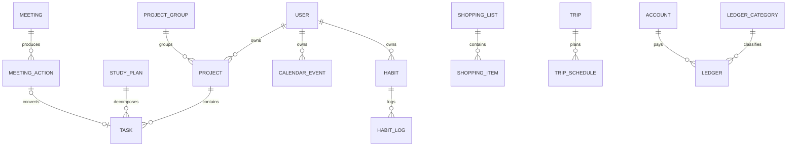

# MiniDesk · 数据库设计

> 版本：v1.0
> 日期：2026-11-12
> 配套：[开发总纲](./MiniDesk开发文档.md) · [接口清单](./接口清单.md)
> 目标库：SQLite（开发）/ MySQL 8.0（生产）/ PostgreSQL 15+（生产）

> **状态提示**：60 张表已落到 `backend/src/main/resources/db/` 的三套建表脚本；文中关于 Liquibase 与生产三库切换的描述属于设计目标，**运行时当前仅支持 SQLite**，详见 [部署指南](./部署指南.md)。§3.6 已按实际实现改写：调度不引入 QRTZ_* 表。

---

## 1. 设计原则

这 6 条决定了后面所有表长什么样，先看这里。

| # | 原则 | 说明 |
|---|---|---|
| 1 | **一切带 `user_id`** | 多账号隔离靠 MyBatis-Plus 租户插件，业务代码不写 `where user_id` |
| 2 | **金额存整数「分」** | 字段 `*_cents BIGINT`。SQLite 的 `DECIMAL` 实际是浮点，跨库必然精度不一致；存分则三库完全一致 |
| 3 | **时间统一 `DATETIME` / 日期 `DATE`** | 不用时间戳整数（可读性差）；业务时区固定 `Asia/Shanghai`，由 JDBC 参数约束 |
| 4 | **软删除 `deleted`** | 仅用于用户可感知的数据（任务/笔记/记账/项目/生活记录）；配置类表物理删除 |
| 5 | **布尔用 `BOOLEAN`** | SQLite 落 0/1，Liquibase 自动映射，Java 侧 `Boolean` |
| 6 | **不做外键约束** | 三库对 FK 行为（级联/延迟）不一致，且 MP 批量操作易踩坑；完整性由 Service 层保证 + 定时清理孤立数据 |

补充约定：

- 主键 `BIGINT` 自增（SQLite `INTEGER PRIMARY KEY AUTOINCREMENT`），前端接收序列化为**字符串**避免 JS 精度丢失
- 排序字段统一 `sort_order INT`，升序
- 扩展字段用 `extra_json TEXT`，**不滥用**（只有确实易变的配置类表才用）
- 表名前缀：业务表无前缀，系统表 `sys_`，第三方 `qrtz_`

---

## 2. 分域与表清单

共 **61 张业务表**（含调度定义表 `sys_schedule_job`，不引入 Quartz 自带的 QRTZ_* 表）。

| 域 | 表 | 数量 |
|---|---|---|
| 系统 | `sys_user` `sys_role` `sys_user_role` `sys_role_permission` `sys_user_setting` `sys_config` `integration_config` `sys_file` `sys_tag` `sys_tag_rel` `sys_favorite` `app_entry` `notification` `job_exec_log` `backup_record` `sys_login_log` `sys_oper_log` | 17 |
| 工作 | `project_group` `project` `task` `calendar_event` `meeting` `meeting_attendee` `meeting_action` `goal` `contact` `review` | 10 |
| 学习 | `study_plan` `study_record` `course` `course_lesson` `book` `book_note` `exam` `exam_question` `skill` `skill_log` | 10 |
| 生活 | `ledger_category` `ledger` `budget` `account` `anniversary` `countdown` `shopping_list` `shopping_item` `habit` `habit_log` `health_record` `profile_item` `trip` `trip_schedule` `life_log` `wish` | 16 |
| 内容 | `note` `note_share` | 2 |
| 扩展 | `journal` `doc_asset` `nav_link` `album` `photo` | 5 |

### 2.1 核心关系



`task` 是全局中枢：一条任务可同时挂项目（`project_id`）、挂学习计划（`plan_id`）、进日历（`due_date`）、被复盘统计（`done_at`）。

---

## 3. 基准 DDL（SQLite 开发库）

> Liquibase changelog 是唯一事实来源，本节的 SQL 由 changelog 生成，用于评审与快速建库。

### 3.1 系统域

```sql
CREATE TABLE sys_user (
  id                 INTEGER PRIMARY KEY AUTOINCREMENT,
  username           VARCHAR(64)  NOT NULL,
  password_hash      VARCHAR(100) NOT NULL,
  nickname           VARCHAR(64)  NOT NULL DEFAULT '朋友',
  email              VARCHAR(128),
  avatar_file_id     BIGINT,
  status             TINYINT      NOT NULL DEFAULT 1,   -- 1正常 0禁用
  source             VARCHAR(16)  NOT NULL DEFAULT 'admin', -- self 自助注册 / admin 后台创建 / init 命令行
  pwd_reset_required TINYINT      NOT NULL DEFAULT 0,   -- 管理员重置后强制改密
  login_count        INTEGER      NOT NULL DEFAULT 0,
  last_login_at      DATETIME,
  last_login_ip      VARCHAR(64),
  remark             VARCHAR(255),
  created_at         DATETIME     NOT NULL,
  updated_at         DATETIME     NOT NULL,
  deleted            TINYINT      NOT NULL DEFAULT 0
);
CREATE UNIQUE INDEX uk_user_username ON sys_user(username);

-- 轻量 RBAC：角色 / 用户角色 / 角色权限码
-- 说明：Sa-Token 采用 jwt 无状态模式，登录态不落库，因此没有 token 表
CREATE TABLE sys_role (
  id         INTEGER PRIMARY KEY AUTOINCREMENT,
  code       VARCHAR(32)  NOT NULL,              -- ADMIN / MEMBER
  name       VARCHAR(64)  NOT NULL,
  built_in   TINYINT      NOT NULL DEFAULT 0,    -- 内置角色不可删
  remark     VARCHAR(255),
  created_at DATETIME     NOT NULL
);
CREATE UNIQUE INDEX uk_role_code ON sys_role(code);

CREATE TABLE sys_user_role (
  id      INTEGER PRIMARY KEY AUTOINCREMENT,
  user_id BIGINT NOT NULL,
  role_id BIGINT NOT NULL
);
CREATE UNIQUE INDEX uk_user_role ON sys_user_role(user_id, role_id);
CREATE INDEX idx_userrole_role ON sys_user_role(role_id);

CREATE TABLE sys_role_permission (
  id              INTEGER PRIMARY KEY AUTOINCREMENT,
  role_id         BIGINT      NOT NULL,
  permission_code VARCHAR(64) NOT NULL           -- work:project:add；ADMIN 存 '*'
);
CREATE UNIQUE INDEX uk_role_perm ON sys_role_permission(role_id, permission_code);

CREATE TABLE sys_user_setting (
  id               INTEGER PRIMARY KEY AUTOINCREMENT,
  user_id          BIGINT       NOT NULL,
  theme            VARCHAR(16)  NOT NULL DEFAULT 'auto',
  sidebar_collapsed TINYINT     NOT NULL DEFAULT 0,
  city             VARCHAR(64)  NOT NULL DEFAULT '北京',
  week_start       TINYINT      NOT NULL DEFAULT 1,
  dashboard_layout TEXT,
  created_at       DATETIME     NOT NULL,
  updated_at       DATETIME     NOT NULL
);
CREATE UNIQUE INDEX uk_setting_user ON sys_user_setting(user_id);

-- 第三方集成密钥（天气 Key / Halo PAT），密文存储
CREATE TABLE integration_config (
  id              INTEGER PRIMARY KEY AUTOINCREMENT,
  user_id         BIGINT       NOT NULL,
  provider        VARCHAR(32)  NOT NULL,          -- qweather / minidocs
  api_key_cipher  TEXT,                            -- AES-256-GCM
  api_host        VARCHAR(255),
  extra_json      TEXT,
  enabled         TINYINT      NOT NULL DEFAULT 0,
  created_at      DATETIME     NOT NULL,
  updated_at      DATETIME     NOT NULL
);
CREATE UNIQUE INDEX uk_integration ON integration_config(user_id, provider);

CREATE TABLE sys_file (
  id          INTEGER PRIMARY KEY AUTOINCREMENT,
  user_id     BIGINT       NOT NULL,
  name        VARCHAR(255) NOT NULL,
  path        VARCHAR(500) NOT NULL,
  thumb_path  VARCHAR(500),
  size        BIGINT       NOT NULL DEFAULT 0,
  mime        VARCHAR(100),
  hash        VARCHAR(32),
  biz_type    VARCHAR(32),                         -- avatar/life_log/note/profile/trip
  biz_id      BIGINT,
  created_at  DATETIME     NOT NULL,
  deleted     TINYINT      NOT NULL DEFAULT 0
);
CREATE INDEX idx_file_user_biz ON sys_file(user_id, biz_type, biz_id);
CREATE INDEX idx_file_hash ON sys_file(user_id, hash);

CREATE TABLE sys_tag (
  id         INTEGER PRIMARY KEY AUTOINCREMENT,
  user_id    BIGINT      NOT NULL,
  name       VARCHAR(32) NOT NULL,
  color      VARCHAR(16),
  created_at DATETIME    NOT NULL
);
CREATE UNIQUE INDEX uk_tag_name ON sys_tag(user_id, name);

CREATE TABLE sys_tag_rel (
  id         INTEGER PRIMARY KEY AUTOINCREMENT,
  user_id    BIGINT      NOT NULL,
  tag_id     BIGINT      NOT NULL,
  biz_type   VARCHAR(32) NOT NULL,
  biz_id     BIGINT      NOT NULL
);
CREATE UNIQUE INDEX uk_tag_rel ON sys_tag_rel(tag_id, biz_type, biz_id);
CREATE INDEX idx_tag_rel_biz ON sys_tag_rel(biz_type, biz_id);

CREATE TABLE sys_favorite (
  id         INTEGER PRIMARY KEY AUTOINCREMENT,
  user_id    BIGINT      NOT NULL,
  biz_type   VARCHAR(32) NOT NULL,
  biz_id     BIGINT      NOT NULL,
  created_at DATETIME    NOT NULL
);
CREATE UNIQUE INDEX uk_favorite ON sys_favorite(user_id, biz_type, biz_id);

-- 首页宫格 / 快速入口（配置化核心）
CREATE TABLE app_entry (
  id         INTEGER PRIMARY KEY AUTOINCREMENT,
  user_id    BIGINT      NOT NULL,
  scope      VARCHAR(16) NOT NULL,                 -- quick/work/study/life
  code       VARCHAR(64) NOT NULL,
  name       VARCHAR(64) NOT NULL,
  icon       VARCHAR(64),
  color      VARCHAR(16),
  route      VARCHAR(128),
  sort_order INTEGER     NOT NULL DEFAULT 0,
  visible    TINYINT     NOT NULL DEFAULT 1
);
CREATE UNIQUE INDEX uk_app_entry ON app_entry(user_id, scope, code);

CREATE TABLE notification (
  id         INTEGER PRIMARY KEY AUTOINCREMENT,
  user_id    BIGINT      NOT NULL,
  type       VARCHAR(32) NOT NULL,                 -- reminder/review/backup/expire
  title      VARCHAR(200) NOT NULL,
  content    VARCHAR(500),
  biz_type   VARCHAR(32),
  biz_id     BIGINT,
  read_flag  TINYINT     NOT NULL DEFAULT 0,
  created_at DATETIME    NOT NULL
);
CREATE INDEX idx_notify_user ON notification(user_id, read_flag, created_at);

-- 全局表（租户插件忽略）
CREATE TABLE job_exec_log (
  id          INTEGER PRIMARY KEY AUTOINCREMENT,
  job_name    VARCHAR(64) NOT NULL,
  started_at  DATETIME    NOT NULL,
  finished_at DATETIME,
  success     TINYINT     NOT NULL DEFAULT 1,
  cost_ms     BIGINT,
  error_msg   VARCHAR(1000),
  trigger_by  VARCHAR(16) DEFAULT 'cron'           -- cron/manual
);
CREATE INDEX idx_job_log ON job_exec_log(job_name, started_at);

CREATE TABLE backup_record (
  id         INTEGER PRIMARY KEY AUTOINCREMENT,
  file_name  VARCHAR(255) NOT NULL,
  size       BIGINT       NOT NULL,
  encrypted  TINYINT      NOT NULL DEFAULT 1,
  status     VARCHAR(16)  NOT NULL DEFAULT 'success',
  remark     VARCHAR(255),
  created_at DATETIME     NOT NULL
);

-- 全局配置（站点级，不属于任何用户）
CREATE TABLE sys_config (
  id           INTEGER PRIMARY KEY AUTOINCREMENT,
  config_key   VARCHAR(64)  NOT NULL,
  config_value VARCHAR(500) NOT NULL,
  remark       VARCHAR(255),
  updated_at   DATETIME     NOT NULL
);
CREATE UNIQUE INDEX uk_config_key ON sys_config(config_key);

-- 登录日志（管理后台审计用，全局表）
CREATE TABLE sys_login_log (
  id         INTEGER PRIMARY KEY AUTOINCREMENT,
  user_id    BIGINT,
  username   VARCHAR(64)  NOT NULL,
  success    TINYINT      NOT NULL,
  fail_reason VARCHAR(100),
  ip         VARCHAR(64),
  user_agent VARCHAR(500),
  created_at DATETIME     NOT NULL
);
CREATE INDEX idx_loginlog_user ON sys_login_log(username, created_at);
CREATE INDEX idx_loginlog_time ON sys_login_log(created_at);

-- 操作审计（管理员写操作，只增不改不删）
CREATE TABLE sys_oper_log (
  id          INTEGER PRIMARY KEY AUTOINCREMENT,
  user_id     BIGINT       NOT NULL,
  username    VARCHAR(64)  NOT NULL,
  module      VARCHAR(32)  NOT NULL,             -- console-user / console-role / backup ...
  action      VARCHAR(32)  NOT NULL,             -- create/update/delete/disable/reset-password
  target_type VARCHAR(32),
  target_id   VARCHAR(64),
  params      VARCHAR(2000),                     -- 参数摘要，已脱敏
  result      VARCHAR(16)  NOT NULL DEFAULT 'success',
  error_msg   VARCHAR(500),
  ip          VARCHAR(64),
  user_agent  VARCHAR(500),
  cost_ms     INTEGER,
  trace_id    VARCHAR(64),
  created_at  DATETIME     NOT NULL
);
CREATE INDEX idx_operlog_user ON sys_oper_log(user_id, created_at);
CREATE INDEX idx_operlog_time ON sys_oper_log(created_at);
```

### 3.2 工作域

```sql
CREATE TABLE project_group (
  id         INTEGER PRIMARY KEY AUTOINCREMENT,
  user_id    BIGINT      NOT NULL,
  name       VARCHAR(64) NOT NULL,
  color      VARCHAR(16),
  sort_order INTEGER     NOT NULL DEFAULT 0,
  created_at DATETIME    NOT NULL
);
CREATE INDEX idx_pgroup_user ON project_group(user_id, sort_order);

CREATE TABLE project (
  id             INTEGER PRIMARY KEY AUTOINCREMENT,
  user_id        BIGINT       NOT NULL,
  group_id       BIGINT,
  name           VARCHAR(120) NOT NULL,
  description    TEXT,
  color          VARCHAR(16)  DEFAULT '#4A86E8',
  status         VARCHAR(16)  NOT NULL DEFAULT 'doing',  -- planning/doing/paused/done/archived
  priority       TINYINT      NOT NULL DEFAULT 2,
  start_date     DATE,
  end_date       DATE,
  progress_cache TINYINT      NOT NULL DEFAULT 0,
  sort_order     INTEGER      NOT NULL DEFAULT 0,
  created_at     DATETIME     NOT NULL,
  updated_at     DATETIME     NOT NULL,
  deleted        TINYINT      NOT NULL DEFAULT 0
);
CREATE INDEX idx_project_user ON project(user_id, status, sort_order);

-- 统一事项表：待办 / 学习任务 / 日常计划 / 会议跟进
CREATE TABLE task (
  id               INTEGER PRIMARY KEY AUTOINCREMENT,
  user_id          BIGINT       NOT NULL,
  module           VARCHAR(16)  NOT NULL DEFAULT 'work',  -- work/study/life
  task_type        VARCHAR(16)  NOT NULL DEFAULT 'todo',  -- todo/study/daily/followup
  title            VARCHAR(200) NOT NULL,
  note             TEXT,
  priority         TINYINT      NOT NULL DEFAULT 2,       -- 1高 2中 3低
  status           VARCHAR(16)  NOT NULL DEFAULT 'todo',  -- todo/doing/done/cancelled
  due_date         DATE,
  due_time         VARCHAR(8),                            -- 'HH:mm'，便于聚合排序
  start_date       DATE,                                  -- 开始日期（开发任务工期）
  start_time       VARCHAR(8),                            -- 'HH:mm'，开始时间
  remind_at        DATETIME,
  repeat_rule      VARCHAR(255),                          -- iCal RRULE
  series_id        BIGINT,                                -- 重复实例指向母任务
  project_id       BIGINT,
  plan_id          BIGINT,
  parent_id        BIGINT,                                -- 子任务
  ref_type         VARCHAR(32),
  ref_id           BIGINT,
  tags             VARCHAR(255),
  estimate_minutes INTEGER,
  sort_order       INTEGER      NOT NULL DEFAULT 0,
  done_at          DATETIME,
  created_at       DATETIME     NOT NULL,
  updated_at       DATETIME     NOT NULL,
  deleted          TINYINT      NOT NULL DEFAULT 0
);
CREATE INDEX idx_task_today   ON task(user_id, status, due_date);
CREATE INDEX idx_task_project ON task(user_id, project_id, sort_order);
CREATE INDEX idx_task_plan    ON task(user_id, plan_id);
CREATE INDEX idx_task_done    ON task(user_id, module, done_at);
CREATE INDEX idx_task_series  ON task(series_id);

CREATE TABLE calendar_event (
  id          INTEGER PRIMARY KEY AUTOINCREMENT,
  user_id     BIGINT       NOT NULL,
  title       VARCHAR(200) NOT NULL,
  description TEXT,
  start_time  DATETIME     NOT NULL,
  end_time    DATETIME,
  all_day     TINYINT      NOT NULL DEFAULT 0,
  location    VARCHAR(200),
  color       VARCHAR(16)  DEFAULT '#35C79B',
  source      VARCHAR(16)  NOT NULL DEFAULT 'manual',  -- manual/meeting
  source_id   BIGINT,
  created_at  DATETIME     NOT NULL,
  updated_at  DATETIME     NOT NULL,
  deleted     TINYINT      NOT NULL DEFAULT 0
);
CREATE INDEX idx_event_time ON calendar_event(user_id, start_time);

CREATE TABLE meeting (
  id           INTEGER PRIMARY KEY AUTOINCREMENT,
  user_id      BIGINT       NOT NULL,
  title        VARCHAR(200) NOT NULL,
  meeting_date DATE         NOT NULL,
  start_time   VARCHAR(8),
  end_time     VARCHAR(8),
  location     VARCHAR(200),
  host         VARCHAR(64),
  content      TEXT,                                    -- Markdown（Vditor）
  project_id   BIGINT,
  created_at   DATETIME     NOT NULL,
  updated_at   DATETIME     NOT NULL,
  deleted      TINYINT      NOT NULL DEFAULT 0
);
CREATE INDEX idx_meeting_date ON meeting(user_id, meeting_date);

CREATE TABLE meeting_attendee (
  id         INTEGER PRIMARY KEY AUTOINCREMENT,
  user_id    BIGINT      NOT NULL,
  meeting_id BIGINT      NOT NULL,
  name       VARCHAR(64) NOT NULL,
  role       VARCHAR(32),
  contact_id BIGINT
);
CREATE INDEX idx_attendee_meeting ON meeting_attendee(meeting_id);

CREATE TABLE meeting_action (
  id         INTEGER PRIMARY KEY AUTOINCREMENT,
  user_id    BIGINT       NOT NULL,
  meeting_id BIGINT       NOT NULL,
  content    VARCHAR(500) NOT NULL,
  owner      VARCHAR(64),
  due_date   DATE,
  task_id    BIGINT,
  status     VARCHAR(16)  NOT NULL DEFAULT 'open'       -- open/done
);
CREATE INDEX idx_action_meeting ON meeting_action(meeting_id);

CREATE TABLE goal (
  id           INTEGER PRIMARY KEY AUTOINCREMENT,
  user_id      BIGINT       NOT NULL,
  module       VARCHAR(16)  NOT NULL DEFAULT 'work',
  period_type  VARCHAR(16)  NOT NULL,                   -- month/quarter/year
  period_key   VARCHAR(16)  NOT NULL,                   -- 2026-11 / 2026-Q4 / 2026
  title        VARCHAR(200) NOT NULL,
  description  TEXT,
  target_value DECIMAL,
  current_value DECIMAL    NOT NULL DEFAULT 0,
  unit         VARCHAR(16),
  progress     TINYINT      NOT NULL DEFAULT 0,
  status       VARCHAR(16)  NOT NULL DEFAULT 'doing',
  created_at   DATETIME     NOT NULL,
  updated_at   DATETIME     NOT NULL
);
CREATE INDEX idx_goal_period ON goal(user_id, module, period_key);

CREATE TABLE contact (
  id             INTEGER PRIMARY KEY AUTOINCREMENT,
  user_id        BIGINT       NOT NULL,
  name           VARCHAR(64)  NOT NULL,
  type           VARCHAR(16)  NOT NULL DEFAULT 'client', -- client/colleague/partner/family
  company        VARCHAR(128),
  position       VARCHAR(64),
  phone          VARCHAR(32),
  email          VARCHAR(128),
  wechat         VARCHAR(64),
  birthday       DATE,
  note           TEXT,
  avatar_file_id BIGINT,
  created_at     DATETIME     NOT NULL,
  deleted        TINYINT      NOT NULL DEFAULT 0
);
CREATE INDEX idx_contact_type ON contact(user_id, type);

CREATE TABLE review (
  id             INTEGER PRIMARY KEY AUTOINCREMENT,
  user_id        BIGINT      NOT NULL,
  module         VARCHAR(16) NOT NULL,                  -- work/study/life
  review_type    VARCHAR(16) NOT NULL,                  -- daily/weekly/monthly
  review_date    DATE        NOT NULL,
  summary        TEXT,
  highlights     TEXT,
  issues         TEXT,
  next_plan      TEXT,
  stats_json     TEXT,                                  -- 统计快照，不重算
  auto_generated TINYINT     NOT NULL DEFAULT 0,
  created_at     DATETIME    NOT NULL,
  updated_at     DATETIME    NOT NULL
);
CREATE UNIQUE INDEX uk_review ON review(user_id, module, review_type, review_date);
```

### 3.3 学习域

```sql
CREATE TABLE study_plan (
  id             INTEGER PRIMARY KEY AUTOINCREMENT,
  user_id        BIGINT       NOT NULL,
  level          TINYINT      NOT NULL,                 -- 1年 2月 3周
  parent_id      BIGINT,
  title          VARCHAR(200) NOT NULL,
  target_hours   DECIMAL      NOT NULL DEFAULT 0,
  done_hours_cache DECIMAL    NOT NULL DEFAULT 0,
  start_date     DATE,
  end_date       DATE,
  status         VARCHAR(16)  NOT NULL DEFAULT 'doing',
  sort_order     INTEGER      NOT NULL DEFAULT 0,
  created_at     DATETIME     NOT NULL,
  updated_at     DATETIME     NOT NULL
);
CREATE INDEX idx_plan_tree ON study_plan(user_id, level, parent_id);

CREATE TABLE study_record (
  id         INTEGER PRIMARY KEY AUTOINCREMENT,
  user_id    BIGINT      NOT NULL,
  subject    VARCHAR(100) NOT NULL,
  minutes    INTEGER     NOT NULL,
  study_date DATE        NOT NULL,
  plan_id    BIGINT,
  note       VARCHAR(500),
  created_at DATETIME    NOT NULL
);
CREATE INDEX idx_study_date ON study_record(user_id, study_date);

CREATE TABLE course (
  id            INTEGER PRIMARY KEY AUTOINCREMENT,
  user_id       BIGINT       NOT NULL,
  name          VARCHAR(200) NOT NULL,
  category      VARCHAR(64),
  total_lessons INTEGER      NOT NULL DEFAULT 0,
  done_lessons  INTEGER      NOT NULL DEFAULT 0,
  cover_file_id BIGINT,
  status        VARCHAR(16)  NOT NULL DEFAULT 'doing',
  start_date    DATE,
  note          TEXT,
  created_at    DATETIME     NOT NULL,
  updated_at    DATETIME     NOT NULL,
  deleted       TINYINT      NOT NULL DEFAULT 0
);
CREATE INDEX idx_course_user ON course(user_id, status);

CREATE TABLE course_lesson (
  id           INTEGER PRIMARY KEY AUTOINCREMENT,
  user_id      BIGINT       NOT NULL,
  course_id    BIGINT       NOT NULL,
  title        VARCHAR(200) NOT NULL,
  sort_order   INTEGER      NOT NULL DEFAULT 0,
  duration_min INTEGER,
  done         TINYINT      NOT NULL DEFAULT 0,
  done_at      DATETIME,
  note         TEXT
);
CREATE INDEX idx_lesson_course ON course_lesson(course_id, sort_order);

CREATE TABLE book (
  id            INTEGER PRIMARY KEY AUTOINCREMENT,
  user_id       BIGINT       NOT NULL,
  title         VARCHAR(200) NOT NULL,
  author        VARCHAR(120),
  category      VARCHAR(64),
  total_pages   INTEGER,
  read_pages    INTEGER      NOT NULL DEFAULT 0,
  status        VARCHAR(16)  NOT NULL DEFAULT 'wish',   -- wish/reading/done
  start_date    DATE,
  finish_date   DATE,
  rating        TINYINT,
  cover_file_id BIGINT,
  created_at    DATETIME     NOT NULL,
  updated_at    DATETIME     NOT NULL,
  deleted       TINYINT      NOT NULL DEFAULT 0
);
CREATE INDEX idx_book_status ON book(user_id, status);

CREATE TABLE book_note (
  id         INTEGER PRIMARY KEY AUTOINCREMENT,
  user_id    BIGINT   NOT NULL,
  book_id    BIGINT   NOT NULL,
  content    TEXT,                                      -- Markdown
  page_no    INTEGER,
  created_at DATETIME NOT NULL
);
CREATE INDEX idx_booknote_book ON book_note(book_id);

CREATE TABLE exam (
  id         INTEGER PRIMARY KEY AUTOINCREMENT,
  user_id    BIGINT       NOT NULL,
  name       VARCHAR(200) NOT NULL,
  exam_date  DATE,
  category   VARCHAR(64),
  status     VARCHAR(16)  NOT NULL DEFAULT 'planning',
  note       TEXT,
  created_at DATETIME     NOT NULL
);
CREATE INDEX idx_exam_date ON exam(user_id, exam_date);

CREATE TABLE exam_question (
  id          INTEGER PRIMARY KEY AUTOINCREMENT,
  user_id     BIGINT  NOT NULL,
  exam_id     BIGINT,
  subject     VARCHAR(64),
  content     TEXT    NOT NULL,
  answer      TEXT,
  analysis    TEXT,
  wrong_count INTEGER NOT NULL DEFAULT 1,
  mastered    TINYINT NOT NULL DEFAULT 0,
  created_at  DATETIME NOT NULL
);
CREATE INDEX idx_question_exam ON exam_question(user_id, exam_id, mastered);

CREATE TABLE skill (
  id           INTEGER PRIMARY KEY AUTOINCREMENT,
  user_id      BIGINT       NOT NULL,
  name         VARCHAR(100) NOT NULL,
  category     VARCHAR(64),
  level        TINYINT      NOT NULL DEFAULT 1,         -- 1-5
  target_level TINYINT      NOT NULL DEFAULT 5,
  progress     TINYINT      NOT NULL DEFAULT 0,
  note         TEXT,
  created_at   DATETIME     NOT NULL
);
CREATE INDEX idx_skill_user ON skill(user_id, category);

CREATE TABLE skill_log (
  id           INTEGER PRIMARY KEY AUTOINCREMENT,
  user_id      BIGINT   NOT NULL,
  skill_id     BIGINT   NOT NULL,
  log_date     DATE     NOT NULL,
  content      TEXT,
  level_before TINYINT,
  level_after  TINYINT,
  created_at   DATETIME NOT NULL
);
CREATE INDEX idx_skilllog ON skill_log(skill_id, log_date);
```

### 3.4 生活域

```sql
CREATE TABLE ledger_category (
  id         INTEGER PRIMARY KEY AUTOINCREMENT,
  user_id    BIGINT      NOT NULL,
  type       VARCHAR(8)  NOT NULL,                      -- income/expense
  name       VARCHAR(32) NOT NULL,
  icon       VARCHAR(64),
  color      VARCHAR(16),
  sort_order INTEGER     NOT NULL DEFAULT 0,
  is_system  TINYINT     NOT NULL DEFAULT 0
);
CREATE UNIQUE INDEX uk_ledger_cat ON ledger_category(user_id, type, name);

CREATE TABLE ledger (
  id           INTEGER PRIMARY KEY AUTOINCREMENT,
  user_id      BIGINT      NOT NULL,
  type         VARCHAR(8)  NOT NULL,
  amount_cents BIGINT      NOT NULL,                    -- 金额：分
  category_id  BIGINT,
  account_id   BIGINT,
  remark       VARCHAR(200),
  occur_date   DATE        NOT NULL,
  tags         VARCHAR(255),
  created_at   DATETIME    NOT NULL,
  updated_at   DATETIME    NOT NULL,
  deleted      TINYINT     NOT NULL DEFAULT 0
);
CREATE INDEX idx_ledger_date ON ledger(user_id, occur_date);
CREATE INDEX idx_ledger_cat ON ledger(user_id, category_id, occur_date);

CREATE TABLE budget (
  id           INTEGER PRIMARY KEY AUTOINCREMENT,
  user_id      BIGINT      NOT NULL,
  period       VARCHAR(8)  NOT NULL,                    -- 2026-11
  category_id  BIGINT,                                  -- 空 = 总预算
  amount_cents BIGINT      NOT NULL,
  created_at   DATETIME    NOT NULL,
  updated_at   DATETIME    NOT NULL
);
CREATE UNIQUE INDEX uk_budget ON budget(user_id, period, category_id);

CREATE TABLE account (
  id                     INTEGER PRIMARY KEY AUTOINCREMENT,
  user_id                BIGINT       NOT NULL,
  name                   VARCHAR(64)  NOT NULL,
  type                   VARCHAR(16)  NOT NULL,         -- bank/cash/alipay/wechat/invest/credit
  initial_balance_cents  BIGINT       NOT NULL DEFAULT 0,
  currency               VARCHAR(8)   NOT NULL DEFAULT 'CNY',
  icon                   VARCHAR(64),
  color                  VARCHAR(16),
  sort_order             INTEGER      NOT NULL DEFAULT 0,
  archived               TINYINT      NOT NULL DEFAULT 0,
  created_at             DATETIME     NOT NULL
);
CREATE INDEX idx_account_user ON account(user_id, archived, sort_order);

CREATE TABLE anniversary (
  id            INTEGER PRIMARY KEY AUTOINCREMENT,
  user_id       BIGINT       NOT NULL,
  title         VARCHAR(100) NOT NULL,
  type          VARCHAR(16)  NOT NULL DEFAULT 'birthday', -- birthday/wedding/memorial
  person        VARCHAR(64),
  date          DATE         NOT NULL,
  lunar         TINYINT      NOT NULL DEFAULT 0,
  repeat_yearly TINYINT      NOT NULL DEFAULT 1,
  advance_days  INTEGER      NOT NULL DEFAULT 3,
  contact_id    BIGINT,
  note          VARCHAR(200),
  created_at    DATETIME     NOT NULL
);
CREATE INDEX idx_anniv_user ON anniversary(user_id, date);

CREATE TABLE countdown (
  id          INTEGER PRIMARY KEY AUTOINCREMENT,
  user_id     BIGINT       NOT NULL,
  title       VARCHAR(100) NOT NULL,
  target_date DATE         NOT NULL,
  type        VARCHAR(16)  NOT NULL DEFAULT 'custom',   -- holiday/trip/goal/custom
  icon        VARCHAR(64),
  color       VARCHAR(16),
  pinned      TINYINT      NOT NULL DEFAULT 0,
  note        VARCHAR(200),
  created_at  DATETIME     NOT NULL
);
CREATE INDEX idx_countdown_date ON countdown(user_id, target_date);

CREATE TABLE shopping_list (
  id           INTEGER PRIMARY KEY AUTOINCREMENT,
  user_id      BIGINT       NOT NULL,
  name         VARCHAR(100) NOT NULL,
  icon         VARCHAR(64),
  budget_cents BIGINT       NOT NULL DEFAULT 0,
  status       VARCHAR(16)  NOT NULL DEFAULT 'open',
  created_at   DATETIME     NOT NULL,
  updated_at   DATETIME     NOT NULL
);
CREATE INDEX idx_slist_user ON shopping_list(user_id, status);

CREATE TABLE shopping_item (
  id           INTEGER PRIMARY KEY AUTOINCREMENT,
  user_id      BIGINT       NOT NULL,
  list_id      BIGINT       NOT NULL,
  name         VARCHAR(120) NOT NULL,
  quantity     DECIMAL      NOT NULL DEFAULT 1,
  unit         VARCHAR(16),
  price_cents  BIGINT       NOT NULL DEFAULT 0,
  category     VARCHAR(32),
  bought       TINYINT      NOT NULL DEFAULT 0,
  bought_at    DATETIME,
  sort_order   INTEGER      NOT NULL DEFAULT 0,
  created_at   DATETIME     NOT NULL
);
CREATE INDEX idx_sitem_list ON shopping_item(list_id, bought, sort_order);

CREATE TABLE habit (
  id            INTEGER PRIMARY KEY AUTOINCREMENT,
  user_id       BIGINT       NOT NULL,
  module        VARCHAR(16)  NOT NULL DEFAULT 'life',   -- study/life
  name          VARCHAR(64)  NOT NULL,
  icon          VARCHAR(64),
  color         VARCHAR(16),
  type          VARCHAR(16)  NOT NULL DEFAULT 'boolean',-- boolean/count
  target_value  INTEGER      NOT NULL DEFAULT 1,
  unit          VARCHAR(16),
  frequency     VARCHAR(255),                           -- RRULE，空=每天
  reminder_time VARCHAR(8),
  archived      TINYINT      NOT NULL DEFAULT 0,
  sort_order    INTEGER      NOT NULL DEFAULT 0,
  created_at    DATETIME     NOT NULL
);
CREATE INDEX idx_habit_user ON habit(user_id, archived, sort_order);

CREATE TABLE habit_log (
  id         INTEGER PRIMARY KEY AUTOINCREMENT,
  user_id    BIGINT   NOT NULL,
  habit_id   BIGINT   NOT NULL,
  log_date   DATE     NOT NULL,
  value      INTEGER  NOT NULL DEFAULT 1,
  note       VARCHAR(200),
  created_at DATETIME NOT NULL
);
CREATE UNIQUE INDEX uk_habit_log ON habit_log(habit_id, log_date);
CREATE INDEX idx_habitlog_user ON habit_log(user_id, log_date);

CREATE TABLE health_record (
  id          INTEGER PRIMARY KEY AUTOINCREMENT,
  user_id     BIGINT      NOT NULL,
  type        VARCHAR(16) NOT NULL,                     -- weight/sleep/exercise
  record_date DATE        NOT NULL,
  value1      DECIMAL,                                  -- 体重kg / 睡眠h / 运动min
  value2      DECIMAL,                                  -- 体脂率 / 深睡h / 距离km
  unit        VARCHAR(16),
  note        VARCHAR(200),
  created_at  DATETIME    NOT NULL
);
CREATE INDEX idx_health_date ON health_record(user_id, type, record_date);

-- 个人档案（含证件，敏感字段加密）
CREATE TABLE profile_item (
  id            INTEGER PRIMARY KEY AUTOINCREMENT,
  user_id       BIGINT       NOT NULL,
  category      VARCHAR(32)  NOT NULL,                  -- id_card/passport/license/insurance/other
  title         VARCHAR(100) NOT NULL,
  content_cipher TEXT,                                  -- AES-256-GCM
  expire_date   DATE,
  remind_days   INTEGER      NOT NULL DEFAULT 30,
  file_id       BIGINT,
  created_at    DATETIME     NOT NULL,
  updated_at    DATETIME     NOT NULL
);
CREATE INDEX idx_profile_user ON profile_item(user_id, category);

CREATE TABLE trip (
  id            INTEGER PRIMARY KEY AUTOINCREMENT,
  user_id       BIGINT       NOT NULL,
  title         VARCHAR(120) NOT NULL,
  destination   VARCHAR(120),
  start_date    DATE,
  end_date      DATE,
  budget_cents  BIGINT       NOT NULL DEFAULT 0,
  cost_cents    BIGINT       NOT NULL DEFAULT 0,
  status        VARCHAR(16)  NOT NULL DEFAULT 'planning',
  cover_file_id BIGINT,
  note          TEXT,
  created_at    DATETIME     NOT NULL,
  updated_at    DATETIME     NOT NULL,
  deleted       TINYINT      NOT NULL DEFAULT 0
);
CREATE INDEX idx_trip_user ON trip(user_id, start_date);

CREATE TABLE trip_schedule (
  id            INTEGER PRIMARY KEY AUTOINCREMENT,
  user_id       BIGINT       NOT NULL,
  trip_id       BIGINT       NOT NULL,
  schedule_date DATE,
  start_time    VARCHAR(8),
  title         VARCHAR(200) NOT NULL,
  location      VARCHAR(200),
  note          TEXT,
  sort_order    INTEGER      NOT NULL DEFAULT 0
);
CREATE INDEX idx_tschedule_trip ON trip_schedule(trip_id, schedule_date, sort_order);

CREATE TABLE life_log (
  id            INTEGER PRIMARY KEY AUTOINCREMENT,
  user_id       BIGINT       NOT NULL,
  title         VARCHAR(200) NOT NULL,
  content       TEXT,
  mood          VARCHAR(16),                            -- happy/calm/tired/sad/excited
  weather       VARCHAR(32),
  location      VARCHAR(120),
  log_date      DATE         NOT NULL,
  cover_file_id BIGINT,
  created_at    DATETIME     NOT NULL,
  updated_at    DATETIME     NOT NULL,
  deleted       TINYINT      NOT NULL DEFAULT 0
);
CREATE INDEX idx_lifelog_date ON life_log(user_id, log_date);

CREATE TABLE wish (
  id          INTEGER PRIMARY KEY AUTOINCREMENT,
  user_id     BIGINT       NOT NULL,
  title       VARCHAR(200) NOT NULL,
  category    VARCHAR(32),
  description TEXT,
  target_date DATE,
  done        TINYINT      NOT NULL DEFAULT 0,
  done_at     DATETIME,
  sort_order  INTEGER      NOT NULL DEFAULT 0,
  created_at  DATETIME     NOT NULL
);
CREATE INDEX idx_wish_user ON wish(user_id, done, sort_order);

CREATE TABLE note (
  id         INTEGER PRIMARY KEY AUTOINCREMENT,
  user_id    BIGINT       NOT NULL,
  module     VARCHAR(16)  NOT NULL DEFAULT 'work',      -- work/study/life
  type       VARCHAR(16)  NOT NULL DEFAULT 'note',      -- note/work_log/idea/memo/diary
  title      VARCHAR(200) NOT NULL,
  content    TEXT,                                      -- Markdown
  tags       VARCHAR(255),
  folder     VARCHAR(64),
  pinned     TINYINT      NOT NULL DEFAULT 0,
  archived   TINYINT      NOT NULL DEFAULT 0,
  word_count INTEGER      NOT NULL DEFAULT 0,
  created_at DATETIME     NOT NULL,
  updated_at DATETIME     NOT NULL,
  deleted    TINYINT      NOT NULL DEFAULT 0
);
CREATE INDEX idx_note_user ON note(user_id, module, type, updated_at);

-- 笔记分享：一篇笔记一条可编辑短链，公开路径 /share/note/{token}
-- password_hash 为空表示无需密码；expire_at 为空表示永久有效
CREATE TABLE note_share (
  id            INTEGER PRIMARY KEY AUTOINCREMENT,
  user_id       BIGINT       NOT NULL,
  note_id       BIGINT       NOT NULL,
  token         VARCHAR(64)  NOT NULL,
  password_hash VARCHAR(100),
  expire_at     DATETIME,
  enabled       TINYINT      NOT NULL DEFAULT 1,
  created_at    DATETIME     NOT NULL,
  updated_at    DATETIME     NOT NULL
);
CREATE UNIQUE INDEX uk_note_share_note ON note_share(user_id, note_id);
CREATE UNIQUE INDEX uk_note_share_token ON note_share(token);
```

### 3.5 扩展表（日志 / 资产 / 导航 / 相册）

```sql
-- 工作日志：日报 / 周报 / 月报 / 年报，模板化 Markdown
CREATE TABLE journal (
  id             INTEGER PRIMARY KEY AUTOINCREMENT,
  user_id        BIGINT       NOT NULL,
  journal_type   VARCHAR(16)  NOT NULL DEFAULT 'daily',   -- daily/weekly/monthly/yearly
  title          VARCHAR(200) NOT NULL,
  period_start   DATE         NOT NULL,
  period_end     DATE         NOT NULL,
  template_key   VARCHAR(32)  NOT NULL DEFAULT 'standard',
  content        TEXT,                                    -- Markdown（Vditor）
  stats_json     TEXT,                                    -- 周期统计快照，不随任务变化重算
  auto_generated TINYINT      NOT NULL DEFAULT 0,
  created_at     DATETIME     NOT NULL,
  updated_at     DATETIME     NOT NULL,
  deleted        TINYINT      NOT NULL DEFAULT 0
);
CREATE INDEX idx_journal_user_period ON journal(user_id, period_start);

-- 文档资产：外链文档（飞书/腾讯）/ 自建 Markdown / 上传文件
CREATE TABLE doc_asset (
  id          INTEGER PRIMARY KEY AUTOINCREMENT,
  user_id     BIGINT       NOT NULL,
  title       VARCHAR(200) NOT NULL,
  doc_type    VARCHAR(16)  NOT NULL DEFAULT 'markdown',  -- markdown/link/file
  provider    VARCHAR(32),                               -- feishu/tencent/yuque/other
  url         VARCHAR(1000),
  content     TEXT,
  file_id     BIGINT,
  category    VARCHAR(64),
  tags        VARCHAR(255),
  description VARCHAR(500),
  pinned      TINYINT      NOT NULL DEFAULT 0,
  created_at  DATETIME     NOT NULL,
  updated_at  DATETIME     NOT NULL,
  deleted     TINYINT      NOT NULL DEFAULT 0
);
CREATE INDEX idx_doc_asset_user ON doc_asset(user_id, doc_type);

-- 导航链接：工作「书签」与学习「资源」共用一张表，用 module 区分
CREATE TABLE nav_link (
  id          INTEGER PRIMARY KEY AUTOINCREMENT,
  user_id     BIGINT       NOT NULL,
  module      VARCHAR(16)  NOT NULL DEFAULT 'work',      -- work/study
  group_name  VARCHAR(64)  NOT NULL DEFAULT '常用',
  title       VARCHAR(120) NOT NULL,
  url         VARCHAR(1000) NOT NULL,
  icon        VARCHAR(255),
  description VARCHAR(255),
  click_count INTEGER      NOT NULL DEFAULT 0,
  sort_order  INTEGER      NOT NULL DEFAULT 0,
  created_at  DATETIME     NOT NULL,
  updated_at  DATETIME     NOT NULL,
  deleted     TINYINT      NOT NULL DEFAULT 0
);
CREATE INDEX idx_nav_link_user ON nav_link(user_id, module, sort_order);

-- 相册
CREATE TABLE album (
  id          INTEGER PRIMARY KEY AUTOINCREMENT,
  user_id     BIGINT       NOT NULL,
  name        VARCHAR(120) NOT NULL,
  description VARCHAR(500),
  cover_url   VARCHAR(1000),
  created_at  DATETIME     NOT NULL,
  updated_at  DATETIME     NOT NULL,
  deleted     TINYINT      NOT NULL DEFAULT 0
);

-- 照片：既支持图床外链（url），也支持本地上传（file_id 反查）
CREATE TABLE photo (
  id         INTEGER PRIMARY KEY AUTOINCREMENT,
  user_id    BIGINT       NOT NULL,
  album_id   BIGINT       NOT NULL,
  title      VARCHAR(200),
  url        VARCHAR(1000) NOT NULL,
  file_id    BIGINT,
  taken_at   DATE,
  sort_order INTEGER      NOT NULL DEFAULT 0,
  created_at DATETIME     NOT NULL,
  deleted    TINYINT      NOT NULL DEFAULT 0
);
CREATE INDEX idx_photo_album ON photo(album_id, sort_order);
```

**`task` 增加两个字段**（本次迭代）：

```sql
ALTER TABLE task ADD COLUMN start_date DATE;
ALTER TABLE task ADD COLUMN start_time VARCHAR(8);   -- 'HH:mm'
```

意义：开发任务需要「开始时间 + 结束时间」才能算工期与冲突。`due_date/due_time` 保持「结束」语义不变，日历聚合时优先用 `start_date` 落点、`due_date` 收尾，两者都为空的才落到当天。

### 3.6 调度表（实际实现，替代原 Quartz JDBC JobStore 方案）

自托管单机场景下没有采用 Quartz 的 11 张 QRTZ_* 表：SQLite 不支持
`SELECT ... FOR UPDATE`，JDBC JobStore 需要自定义 delegate；而且会让「一个 SQLite 文件
就是全部数据」多出一套方言脚本。实际做法是 **Quartz 的 RAMJobStore 负责触发，任务定义
与执行历史落在业务库**：

- `sys_schedule_job`（第 60 张表）：任务定义、Cron、启停、最近一次结果与下次触发时间，是唯一事实来源；
- `job_exec_log`：每次执行的开始/结束时间、成功摘要 `message`、错误、耗时与触发方式；
- 启动时 `ScheduleBootstrap` 按库里的定义重建 trigger，用户改过的 Cron 不会被覆盖。

```sql
CREATE TABLE IF NOT EXISTS sys_schedule_job (
  id           INTEGER PRIMARY KEY AUTOINCREMENT,
  job_code     VARCHAR(64)  NOT NULL,
  job_name     VARCHAR(100) NOT NULL,
  description  VARCHAR(255),
  cron_expr    VARCHAR(64)  NOT NULL,
  enabled      TINYINT      NOT NULL DEFAULT 1,
  allow_manual TINYINT      NOT NULL DEFAULT 1,
  sort_order   INTEGER      NOT NULL DEFAULT 0,
  last_run_at  DATETIME,
  last_status  VARCHAR(16),
  last_cost_ms BIGINT,
  last_error   VARCHAR(500),
  next_run_at  DATETIME,
  created_at   DATETIME     NOT NULL,
  updated_at   DATETIME     NOT NULL
);
CREATE UNIQUE INDEX IF NOT EXISTS uk_schedule_job ON sys_schedule_job(job_code);
```

`job_exec_log.message` 由 `SchemaUpgrade` 以幂等 `ALTER` 补齐，老库无需重建。
`UserTenantHandler` 把 `sys_schedule_job` / `job_exec_log` 列为全局表（无 `user_id`）。

代价：不支持集群调度与 misfire 补跑；重启后按当前时间和 Cron 重新计算下次触发。

---

## 4. 索引与性能

### 4.1 索引设计要点

| 表 | 索引 | 支撑的查询 |
|---|---|---|
| `task` | `(user_id, status, due_date)` | 首页今日待办、日历聚合 |
| `task` | `(user_id, project_id, sort_order)` | 项目详情任务列表 |
| `task` | `(user_id, module, done_at)` | 复盘统计「今日完成」 |
| `ledger` | `(user_id, occur_date)` | 月度账单、预算汇总 |
| `habit_log` | `(habit_id, log_date)` 唯一 | 热力图按习惯取整年 |
| `study_record` | `(user_id, study_date)` | 周/月时长统计 |
| `notification` | `(user_id, read_flag, created_at)` | 未读数 + 列表 |
| `note` | `(user_id, module, type, updated_at)` | 笔记列表、日记列表 |
| `note_share` | `(token)` 唯一 | 公开分享页按短链解析 |

**复合索引顺序原则**：`user_id` 永远第一（租户条件必带），其次是等值条件（status/module），最后是范围或排序字段（due_date/created_at）。

### 4.2 统计类查询的处理

- 周/月学习时长：`select study_date, sum(minutes) from study_record where user_id=? and study_date between ? and ? group by study_date` —— 走 `idx_study_date`，覆盖索引，万级数据 <5ms
- 记账月度汇总：同上，按 `type` 分组
- 项目管理进度：`progress_cache` 冗余字段，在任务状态变更时更新；不每次 count
- 习惯热力图：一次取一年 `habit_log`（约 365 行），内存渲染
- 连续学习天数：取最近 400 条 `study_date` 去重降序，内存遍历

### 4.3 数据量估算（单用户 5 年）

| 表 | 行数 | 说明 |
|---|---|---|
| `task` | ~12,000 | 日均 6-7 条 |
| `ledger` | ~30,000 | 日均 16 笔 |
| `habit_log` | ~10,000 | 6 个习惯 × 5 年 |
| `study_record` | ~2,500 | 日均 1.4 次 |
| `note` | ~3,000 | — |
| `life_log` | ~2,000 | — |
| `calendar_event` | ~1,500 | — |
| **合计** | **~65,000 行** | 库文件 <60MB |

**结论**：单表最大 3 万行，不需要分区、不需要 ES、不需要读写分离。搜索用 `LIKE '%kw%'` 即可（3 万行全表扫约 20ms），后续若变慢再上 SQLite FTS5 / MySQL FULLTEXT。

---

## 5. 三库同步策略

### 5.1 单一事实来源：Liquibase

不维护三份手写 DDL（必然漂移）。用 Liquibase changelog 定义 schema，三种数据库自动生成各自方言。

```
src/main/resources/db/changelog/
├─ db.changelog-master.yaml
├─ 001-system.yaml
├─ 002-work.yaml
├─ 003-study.yaml
├─ 004-life.yaml
├─ 005-note.yaml
├─ 006-quartz-{sqlite|mysql|postgres}.yaml   # 按 dbms 条件引入
└─ 010-seed.yaml
```

ChangeSet 只使用**抽象类型**，由 Liquibase 映射：

| 声明 | SQLite | MySQL | PostgreSQL |
|---|---|---|---|
| `BIGINT` | INTEGER | BIGINT | BIGINT |
| `VARCHAR(n)` | VARCHAR(n) | VARCHAR(n) | VARCHAR(n) |
| `DATETIME` | DATETIME | DATETIME | TIMESTAMP |
| `DATE` | DATE | DATE | DATE |
| `TEXT` | TEXT | TEXT | TEXT |
| `BOOLEAN` | TINYINT(1) | TINYINT(1) | BOOLEAN |
| `DECIMAL` | NUMERIC | DECIMAL | NUMERIC |
| 自增主键 | `INTEGER PRIMARY KEY AUTOINCREMENT` | `AUTO_INCREMENT` | `GENERATED BY DEFAULT AS IDENTITY` |

**自增主键是唯一必须分方言的地方**，用 `<modifySql dbms="sqlite">` 或为每种库写 `addAutoIncrement`。金额已改存分，避开了 DECIMAL 精度差异这个更大的坑。

### 5.2 导出三套完整 SQL（交付要求）

```bash
# SQLite（开发库）
mvn liquibase:updateSQL -Dliquibase.url=jdbc:sqlite:./data/minidesk.db \
    -Dliquibase.outputFile=docs/sql/schema-sqlite.sql

# MySQL 8
mvn liquibase:updateSQL -Dliquibase.url="jdbc:mysql://localhost:3306/minidesk" \
    -Dliquibase.username=root -Dliquibase.password=*** \
    -Dliquibase.outputFile=docs/sql/schema-mysql.sql

# PostgreSQL
mvn liquibase:updateSQL -Dliquibase.url="jdbc:postgresql://localhost:5432/minidesk" \
    -Dliquibase.username=postgres -Dliquibase.password=*** \
    -Dliquibase.outputFile=docs/sql/schema-postgres.sql
```

产物放 `docs/sql/`，随版本号提交（`schema-mysql-v1.0.sql`）。**这三份文件即最终交付的建库脚本**，与 changelog 同源，不会漂移。

### 5.3 方言禁用清单

业务代码里**禁止**出现：

| 禁用 | 替代 |
|---|---|
| `IFNULL` / `ISNULL` | `COALESCE`（三库都支持） |
| `DATE_FORMAT(d, '%Y-%m')` | Java 侧截取，或 `substr(d,1,7)`（SQLite/PG 通用） |
| `LIMIT 10, 20` | MyBatis-Plus 分页插件 |
| `GROUP_CONCAT` | `STRING_AGG`（MySQL 需 8.0+；或 Java 聚合） |
| 反引号标识符 | 不加引号 |
| `NOW()` | `CURRENT_TIMESTAMP`（标准），但仍建议 Java 传时间 |

### 5.4 SQLite 专属配置（开发期必做）

```yaml
spring.datasource.hikari.connection-init-sql: PRAGMA journal_mode=WAL;
spring.datasource.hikari.maximum-pool-size: 8   # SQLite 写并发弱，池不宜大
```

另需在 Druid/Hikari 初始化连接时执行：

```sql
PRAGMA journal_mode = WAL;
PRAGMA synchronous = NORMAL;
PRAGMA busy_timeout = 5000;
PRAGMA foreign_keys = OFF;
```

WAL 模式下读写不互斥，配合 `busy_timeout` 可基本消除 `database is locked`。若仍偶发（Quartz 与用户操作同时写），把 Job 的写操作串行化到一个单线程执行器。

---

## 6. 初始化种子数据

### 6.1 记账分类（默认 12 个，注册时生成）

```sql
-- expense
餐饮 交通 购物 居住 娱乐 医疗 教育 人情 通讯 其他
-- income
工资 奖金 理财 兼职 红包 其他
```

### 6.2 首页宫格（22 条，`scope` 区分）

```sql
-- 快捷入口 scope='quick'（6 条）
('quick','note.new','新建笔记','lucide:file-plus','#35C79B','/note/new',1)
('quick','task.new','新建待办','lucide:check-square','#4A86E8','/todo?new=1',2)
('quick','diary.new','写日记','lucide:pen-line','#FF9F43','/life/diary?new=1',3)
('quick','ledger.new','记账','lucide:wallet','#FF6B6B','/life/ledger?new=1',4)
('quick','anniversary','生日提醒','lucide:cake','#8B7CF6','/life/anniversary',5)
('quick','more','更多应用','lucide:grid-3x3','#9AA8B2','/settings/apps',6)

-- 工作 scope='work'（8 条）、学习 scope='study'（8 条）、生活 scope='life'（8 条）
```

完整 22 条在 `010-seed.yaml` 中维护，新增应用只改种子数据，不改前端。

### 6.3 默认习惯

喝水（8 杯）、早睡（23:30 前）、运动（30 分钟）、阅读（20 页）—— 均为 `count` 或 `boolean` 类型，首次使用打卡模块时引导添加，不默认插入。

### 6.4 角色与权限码

```sql
INSERT INTO sys_role (code, name, built_in, remark, created_at) VALUES
('ADMIN',  '管理员',   1, '系统管理：账号、备份、调度、集成配置', now),
('MEMBER', '家庭成员', 1, '全部业务功能，无系统管理权限', now);

-- ADMIN 用通配符，不必逐条维护
INSERT INTO sys_role_permission (role_id, permission_code) VALUES (1, '*');

-- MEMBER 按模块授予（示例片段）
INSERT INTO sys_role_permission (role_id, permission_code) VALUES
(2, 'work:*'), (2, 'study:*'), (2, 'life:*'),
(2, 'shared:*'),
(2, 'system:setting:update');
```

权限码命名：`模块:资源:动作`，动作仅限 `query / add / update / delete / export / import / manage`。
新模块上线必须同时补权限码常量（`framework/satoken/PermissionCodes`）与角色授权种子，否则非 ADMIN 账号会被拦成 403。

### 6.5 注册时的默认数据

新账号创建时按顺序写入：`sys_user` → `sys_user_role(MEMBER)` → `sys_user_setting`（城市、主题）→ 12 条 `ledger_category` → 22 条 `app_entry`。

整体在一个事务内完成；`app_entry` 与 `ledger_category` 来自字典模板，模板变更不影响已注册账号。

### 6.6 全局配置（`sys_config`）

```sql
INSERT INTO sys_config (config_key, config_value, remark, updated_at) VALUES
('site_name',           'MiniDesk',  '站点名称',               now),
('allow_register',      'true',      '是否开放自助注册',        now),
('install_claimed',     'false',     '首个管理员是否已被注册领取', now),
('password_min_length', '8',         '密码最小长度',            now),
('login_fail_limit',    '5',         '登录失败锁定阈值',         now),
('login_lock_minutes',  '15',        '锁定时长（分钟）',         now),
('audit_keep_days',     '180',       '审计日志保留天数',         now),
('backup_keep',         '7',         '备份保留份数',            now);
```

`install_claimed` 是并发注册的抢占开关：首个用户注册时执行

```sql
UPDATE sys_config SET config_value = 'true' WHERE config_key = 'install_claimed' AND config_value = 'false';
```

影响行数为 1 才算抢到 ADMIN 资格，否则降级为 MEMBER。比「先查 count 再插」在并发下更可靠。

---

## 7. 迁移与版本

| 版本 | 变更 | 时间 |
|---|---|---|
| v1.0 | 初始 54 表 | 2026-11 |
| v1.1 | 新增 `journal` `doc_asset` `nav_link` `album` `photo`；`task` 增加 `start_date` `start_time` | 2026-11 |

规则：

- 任何表结构变更必须新增 changeset，**不改历史 changeset**（已执行过的 checksum 会冲突）
- 破坏性变更（删列/改类型）走「新增列 → 双写 → 迁移数据 → 删旧列」三步，分版本发布
- 每季度做一次「备份恢复演练」，验证 changelog 从零建库可用

---

*文档结束。配套接口定义见 [接口清单](./接口清单.md)。*
